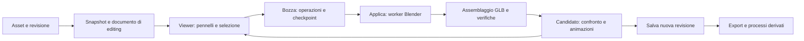

# Editor guidato dei modelli nella web app

Data: 14 ottobre 2026. Repository studiata: AssetFurnace, base `6042e60`.

**Priorità aggiornata il 15 ottobre:** l'utente ha ridotto la richiesta a [Apri in Blender → esporta GLB → importa come nuova versione](2026-10-15-blender-roundtrip.md). Il presente editor guidato è rimandato; piano, revisione e prove restano come storico. I suoi gate non sono criteri di rilascio del flusso manuale.

**Stato: implementazione avviata, prove S0/RIG0 in corso.** Sono presenti i primi controlli GLB e moduli numerici; la web app non dispone ancora dell'editor e i gate non sono conclusi. [Avanzamento, codice e risultati](2026-10-14-guided-model-editor-progress.md). Le decisioni architetturali sotto restano il contratto da verificare. Ricerca su fonti primarie svolta il 13–14 ottobre 2026. [Revisione indipendente](2026-10-14-guided-model-editor-review.md), riferita alla versione del piano precedente a questo aggiornamento di stato.

**Estensione del 14 ottobre:** la richiesta comprende ora anche correzione guidata dello scheletro, modifica dei pesi e studio delle ossa mancanti. Il contratto tecnico è in §14; requisiti, dipendenze e criteri di rilascio sotto includono questa estensione. La precedente revisione del solo editor di forma resta nello storico del report.

## 1. Risultato richiesto

L'utente apre un modello della Library, entra in **Modifica**, corregge una zona direttamente nella preview e applica il risultato come nuova versione. Può spostare, gonfiare/sgonfiare, levigare, aprire una fessura e staccare un pezzo. Può farlo sul modello fermo oppure fermando un'animazione; la modifica cambia la forma di base e viene verificata anche nelle altre animazioni.

Nello stesso ambiente può correggere la posizione delle articolazioni e l'influenza delle ossa sulla superficie. Un passaggio successivo della roadmap aggiunge catene mancanti con guida anatomica, iniziando dalle dita; questo richiede nuova mappatura delle animazioni e verifica della consegna UE, non soltanto nuovi segmenti disegnati nel viewer.

La funzione deve rendere accessibili poche operazioni frequenti sui modelli generati. L'interfaccia resta quella di AssetFurnace, con strumenti guidati e Blender come processo di elaborazione. Non è previsto un editor 3D generalista.

Requisiti già decisi dall'utente:

| Requisito | Comportamento di rilascio |
| --- | --- |
| Correggere la forma | Pennelli Sposta, Gonfia/Sgonfia, Leviga; raggio e intensità, protezione delle zone da conservare |
| Anteprima immediata, poi Applica | Forma aggiornata durante il gesto; elaborazione definitiva asincrona con confronto prima/dopo |
| Separare parti fuse | Aprire una fessura, mantenendo gli attacchi voluti; staccare una regione in una parte selezionabile |
| Lavorare anche in animazione | Pausa e modifica della forma generale; nessuna correzione limitata a una singola posa |
| Controllare altri movimenti | Preview interattiva di tutte le clip compatibili e rapporto delle pose campionate |
| Sistemare lo scheletro | Riposizionare articolazioni esistenti in posa di riposo, simmetria opzionale e frame di riferimento; calibrare separatamente la direzione della piega nelle clip (§14.7); mesh a riposo preservata |
| Sistemare la deformazione | Selezionare una zona e aumentare/ridurre/levigare l'influenza di un osso, con protezioni e preview anche in posa |
| Completare ossa mancanti | Fase dedicata a catene guidate delle dita, con pesi e mappatura dei movimenti; nessuna promessa di animazione dedotta dalla sola presenza dell'osso |
| Semilavorati e metadati | Sorgente, bozza recuperabile, operazioni, candidato, versione accettata, verifiche e artefatti derivati collegati |
| Arrivare a UE | Export costruito dalla revisione scelta, verificabile in Unreal; nessun riuso silenzioso del vecchio modello |

Il primo rilascio utile esteso comprende **entrambi gli strumenti di separazione, la modifica in posa, le articolazioni esistenti, i pesi e la calibrazione della piega per gomiti/ginocchia supportati**. La consegna completa della roadmap comprende anche la fase RIG4 sulle catene mancanti. Una milestone con i soli pennelli può essere provata internamente, ma non soddisfa l'intera richiesta.

### Confini e aspettative

- Un pennello modifica geometria esistente. Non ricostruisce anatomia assente o un corpo mai generato sotto un vestito.
- Separare dita fuse non crea automaticamente ossa delle dita mancanti: il comando guidato di §14.6 è un intervento successivo e distinto. Staccare un tabarro non aggiunge simulazione del tessuto.
- Una macchia può dipendere da texture, normali o geometria: il confronto Materiale/Clay/Normali resta immediatamente disponibile. Il texture painting non fa parte di questo rilascio.
- Sono inclusi correzione guidata di articolazioni, pesi manuali locali e catene mancanti secondo §14. Restano esclusi rigging generalista con vincoli/driver, creazione libera di sistemi IK, UV manuali, morph correttivi, authoring di nuove animazioni e sculpting con dettaglio illimitato. Il retarget necessario a riutilizzare le clip esistenti è incluso.
- Nessuna analisi AI obbligatoria, chiamata a modelli generativi o nuova chiave API. Un assistente potrà in futuro proporre operazioni tramite gli stessi contratti, senza diventare un prerequisito della modifica manuale.

## 2. Evidenze nella repository e conseguenze

I percorsi qui sotto sono relativi alla repository; i link sono navigabili da questo documento.

| Componente esistente | Evidenza e integrazione necessaria |
| --- | --- |
| [Studio](../../viewer/studio.html), [app.js](../../viewer/studio/app.js) | Library, viewer e Steps già esistono. Aggiungere un modo Modifica nel viewer, senza un secondo sito o una riscrittura del frontend. |
| [viewer.js](../../viewer/studio/viewer.js) | Orbit, Clay, Normali, ossa, timeline e caricamento clip. Espone oggi un'API limitata; aggiungere controller di editing e hook di caricamento/dispose. Cambiare clip oggi può caricare un altro GLB. |
| [model-viewport.js](../../viewer/components/model-viewport.js) | Three.js con GLTFLoader. Centra e scala il modello per mostrarlo: queste trasformazioni di presentazione non devono finire nei dati salvati. Conservare trasformazioni di origine e matrici esplicite. |
| [Three vendorizzato](../../viewer/vendor/three.module.js) | Revisione r170. Le documentazioni upstream possono riferirsi a versioni diverse: testare le dipendenze sulla versione realmente usata. |
| [player.js](../../viewer/animation/player.js) | Mixer, pausa e seek già disponibili. Congelare tempo e scheletro durante il tratto; usare secondi reali, non il valore 30 FPS mostrato dalla UI come identità di una posa. |
| [serve.py](../../viewer/serve.py), [generate_api.py](../../viewer/generate_api.py) | Il server usa `ThreadingHTTPServer`; il vero Handler e il dispatch GET/POST sono in `generate_api.py`. Collegare qui il nuovo modulo API. |
| [finish_api.py](../../viewer/finish_api.py), [autorig_api.py](../../viewer/autorig_api.py) | Pattern già presenti: subprocess, avanzamento, cancellazione, copia dell'input. Riutilizzare i meccanismi utili senza copiare assunzioni su cartelle o schemi incompatibili. |
| [assets_api.py](../../viewer/assets_api.py) | Ricostruisce asset da nomi/hash e seleziona gli stage più recenti. Le revisioni richiedono legami espliciti: non basta aggiungere una cartella e sperare che venga raggruppata correttamente. |
| [activity_api.py](../../viewer/activity_api.py) | La cronologia della catena non garantisce da sola la registrazione di una chiamata diretta a un nuovo endpoint. Gli eventi di editing devono essere persistiti anche fuori da ChainRunner. |
| [blender.py](../../image_to_3dlab/blender.py), [processes.py](../../image_to_3dlab/processes.py) | Discovery di Blender, controllo versione e gestione processi da riusare. Il minimo corrente 4.2 non certifica automaticamente gli operatori nuovi. |
| [mesh_health.py](../../scripts/mesh_health.py) | Audit geometrico già presente. Il weld per posizione usato per alcune misure non è un algoritmo sicuro per ricostruire l'identità dei vertici da modificare. |
| [glb_turn.py](../../image_to_3dlab/glb_turn.py), [glb_forensics.py](../../scripts/glb_forensics.py) | Esistono già parse/build dei chunk GLB e ispezione dei materiali senza normalizzazione da parte di trimesh. Riutilizzare e irrobustire queste utilità; non assumere che il loro profilo ristretto copra già tutti gli accessors dell'editor. |
| [clean_skin_weights.py](../../scripts/clean_skin_weights.py), [rig_check.py](../../scripts/rig_check.py) | Utili come riferimenti per pesi e compatibilità dei rig. Nessuna pulizia globale dei pesi applicata automaticamente a ogni pennellata. |
| [rig_api.py](../../viewer/rig_api.py), [blender_rebind.py](../../scripts/blender_rebind.py), [rig_sidecar.py](../../image_to_3dlab/rig_sidecar.py) | Esistono job di rebind e correzioni con ID persistenti, ma richiedono una scena Blender preparata e un profilo Rigify. Non sono già un editor universale per i GLB SkinTokens. |
| [Profilo Rigify presente](../../rigs/profiles/rigify.basic-quadruped.blender-5.2.v1.json), [blender_rebind_weights.py](../../scripts/blender_rebind_weights.py) | Il profilo presente è un quadrupede Blender 5.2. Il worker rigenera Rigify e tutti i pesi tramite proxy voxel; non conserva le correzioni locali come richiede il nuovo editor. |
| [kimodo_retarget.py](../../scripts/kimodo_retarget.py), [test relativi](../../tests/test_kimodo_retarget.py) | Mappa rig SkinTokens su SOMA77 con euristiche di struttura/posizione. Mani incomplete e ossa extra hanno fallback: l'aggiunta guidata di un dito richiede mapping esplicito, non solo rilancio invariato dello script. |
| [provenance.py](../../image_to_3dlab/provenance.py) | Conservare provenienza e classificazione delle licenze originali. La licenza di uno strumento non diventa quella dell'asset. |
| [test_studio_modules.py](../../tests/test_studio_modules.py), [test_viewer_assets_api.py](../../tests/test_viewer_assets_api.py) | Esistono test Python e test dei moduli JS eseguiti con Node. Aggiungere fixture geometriche piccole e riproducibili nello stesso stile. |

Il guerriero già sperimentato è un caso manuale utile, non una fixture necessaria alla CI. Gli esperimenti locali sulle mani hanno migliorato una misura geometrica senza risolvere ogni difetto visivo; quelli sui pesi del tessuto non hanno dato una correzione accettabile. Una macchia del tabarro cambia passando a Clay: il contributo dei materiali va distinto da quello della forma. Questi risultati motivano selezione locale, confronto e possibilità di annullare; non provano una riparazione universale.

## 3. Flusso dell'interfaccia

1. **Library → modello → Modifica.** Selezionare esplicitamente lo stage/revisione di partenza. Il server prepara una copia e dichiara gli strumenti disponibili. L'apertura di un GLB locale, oggi solo visualizzazione, richiede prima un'importazione nella Library con snapshot e provenienza.
2. **Scegliere la zona.** Clic sulla parte, pennello di selezione o contorno; aggiungere/togliere dalla selezione. Una maschera Proteggi impedisce modifiche. Selezione iniziale solo della superficie visibile; attraversare il modello è un'opzione esplicita, disattivata inizialmente.
3. **Correggere.** Due modalità nel medesimo viewer: Forma e Scheletro. Forma contiene Sposta, Gonfia, Leviga, Separa; sotto Separa: Apri fessura / Stacca parte. Scheletro contiene Articolazioni e Influenze; in Articolazioni distinguere Sposta e Direzione della piega, mentre il frame di riferimento resta un controllo avanzato. Completa dita compare quando disponibile in RIG4. Il pannello mostra solo i controlli del comando corrente. Materiale/Clay, undo/redo e prima/dopo sempre raggiungibili.
4. **In animazione.** Pausa al tempo desiderato; indicazione «La correzione vale in tutte le animazioni». Forma e Influenze agiscono subito sulla posa corrente, con i rispettivi contratti. Separazione e cambi strutturali dello scheletro passano attraverso la conferma in posa di riposo (§7 e §14), poi ritornano alla clip per la verifica.
5. **Applica.** Congela la bozza corrente, avvia elaborazione e verifiche; permette annullamento del job. Gli strumenti sono disabilitati per quel candidato mentre l'utente può ispezionare il modello.
6. **Confronta e salva versione.** Il candidato si può osservare, animare e confrontare. La pagina mostra eventuali zone da controllare, senza un punteggio opaco di «qualità». Salva versione la rende la versione selezionata dell'asset; Torna alla modifica conserva la bozza. Un errore lascia disponibile l'ultima versione valida.
7. **Cronologia.** Nel pannello del modello: sorgente, versione precedente, operazioni con parametri, data, versione degli strumenti, risultati delle verifiche e download. La bozza è distinta dalla versione utilizzabile dai processi successivi.

Microcopy e casi di errore:

| Situazione | Risposta utile |
| --- | --- |
| Blender assente/incompatibile | «Serve Blender per applicare queste modifiche», collegamento al setup esistente; dichiararlo prima dell'inizio del lavoro |
| Zona selezionata ambigua tra due strati | Evidenziare i due strati e chiedere di restringere la selezione; non scegliere automaticamente quello più vicino |
| Taglio non elaborabile | Conservare tracciato e maschera; indicare la zona problematica e permettere modifica del taglio o download per Blender |
| Posa numericamente instabile | «Questa posa comprime troppo la zona. Correggila in posa di riposo», conservando selezione e lavoro precedente |
| Cambio asset con bozza non sincronizzata | Offrire attesa del salvataggio, permanenza o scarto; indicare quali gesti non sono ancora salvati |
| Nessuna clip compatibile disponibile | Forma modificabile a riposo; verifica animazioni dichiarata non eseguita |

Desktop con mouse e tastiera è il primo obiettivo. Orbit e pennello devono essere mutuamente esclusivi durante il gesto; pointer capture, Esc annulla il tratto, Ctrl/Cmd+Z annulla, redo accessibile, controlli numerici oltre agli slider. Stato salvato/elaborazione/errore leggibile anche senza colore. Le scorciatoie non intercettano la digitazione nei campi. La visualizzazione su touch può restare disponibile; niente promessa iniziale di sculpting mobile o pen pressure.

## 4. Architettura scelta e ricerca

**Browser: interazione e anteprima. Server: sessioni, versioni, verifiche e orchestrazione. Blender headless: operazioni geometriche definitive e trattamento locale dei dati dopo un taglio.** Nessun nuovo servizio GPU necessario per questa feature.



Decisioni basate sulla ricerca; non sono risultati di un benchmark di AssetFurnace:

| Risorsa | Evidenza utile | Decisione |
| --- | --- | --- |
| [Three SkinnedMesh](https://threejs.org/docs/pages/SkinnedMesh.html) | Skinning, matrici di bind e aggiornamento bounds sono responsabilità esplicite del chiamante. | Estendere il viewer; verificare il comportamento effettivo su r170. |
| [three-mesh-bvh](https://github.com/gkjohnson/three-mesh-bvh), [API](https://github.com/gkjohnson/three-mesh-bvh/blob/master/API.md), [manifest](https://github.com/gkjohnson/three-mesh-bvh/blob/master/package.json) | Accelerazione di query sulla mesh, refit e modalità indirect. Il manifest consultato riporta 0.9.15 e peer Three >=0.159.0. Licenza MIT. | Candidato per selezione/picking; r170 soddisfa il vincolo dichiarato, ma occorre prova di esecuzione. Pin di versione e hash, copia locale e notice. |
| [SculptGL](https://github.com/stephomi/sculptgl) | Riferimento MIT per pennelli e UX; repository archiviata nel gennaio 2026. | Studiare algoritmi e piccoli componenti, evitando di incorporare un intero editor non mantenuto. |
| [three-bvh-csg](https://github.com/gkjohnson/three-bvh-csg) | Progetto MIT sperimentale; richiede input chiusi/manifold e segnala casi limite. | Non usarlo come motore definitivo dei tagli. Anteprima browser del volume di taglio, senza garantire una mesh finale istantanea. |
| [Blender Boolean API](https://docs.blender.org/api/4.5/bpy.types.BooleanModifier.html), [BMesh](https://docs.blender.org/api/5.0/bmesh.ops.html) | Exact e operatori di separazione disponibili; le opzioni per casi problematici non garantiscono una riparazione generale. | Prima scelta: Boolean Exact per sottrazione su solidi idonei, operazioni di facce/bordi per staccare superfici. Adapter verificato sulle versioni supportate. |
| [Blender Data Transfer](https://docs.blender.org/api/4.5/bpy.types.DataTransferModifier.html), [manuale](https://docs.blender.org/manual/en/3.6/modeling/modifiers/modify/data_transfer.html) | Trasferimenti interpolati e per dominio; i dati per vertice e quelli per angolo di faccia hanno semantiche diverse. | Riutilizzare principi e operatori dove appropriato, con vincoli sulla parte sorgente. Nessun nearest-neighbor indiscriminato su dita o stoffa sovrapposte. |
| [Manifold](https://github.com/elalish/manifold) | Libreria Apache-2.0, anche WASM/Python; le garanzie dipendono dalla validità manifold degli input. | Alternativa da valutare solo se il benchmark dei tagli lo giustifica. Non introdurre contemporaneamente due motori definitivi. |
| [glTF 2.0](https://registry.khronos.org/glTF/specs/2.0/glTF-2.0.html), [Blender glTF IO](https://github.com/KhronosGroup/glTF-Blender-IO/blob/main/docs/blender_docs/scene_gltf2.rst) | Attributi, skin, animazioni e materiali hanno riferimenti distinti; UV e normali discontinue possono duplicare vertici in esportazione. | Documento canonico e mappature esplicite; nessuna equivalenza assunta tra indice Three e indice Blender. |
| [glTF Validator](https://github.com/KhronosGroup/glTF-Validator) | Controlla struttura e riferimenti glTF; licenza Apache-2.0. | Validazione locale del file finale, insieme a controlli geometrici e visivi separati. Pin del binario/pacchetto, senza inviare asset a un servizio web. |
| [Epic: pipeline skeletal mesh FBX](https://dev.epicgames.com/documentation/en-us/unreal-engine/fbx-skeletal-mesh-pipeline-in-unreal-engine) | Import di mesh e scheletro, materiali e triangolazione hanno vincoli propri; la documentazione indica FBX 2020.2. | Verifica reale sull'UE usato dal progetto Unreal fratello. Non dedurre la compatibilità dall'estensione .fbx o dal solo successo dell'export Blender. |

Alcune pagine del manuale Blender hanno restituito errore di fetch completo: per queste voci sono stati consultati i risultati indicizzati delle fonti ufficiali e la documentazione del repository Khronos. Durante S0 fissare versioni e operatori mediante prove locali, non mediante la sola documentazione `latest`.

## 5. Documento di editing e identità della geometria

Questo è il contratto più importante. Non inviare «vertice 123» dal browser a un GLB reimportato in Blender: l'import/export può dividere, fondere o riordinare i vertici.

### Formato proposto: `EditDocument v1`

Creare un decoder/assembler GLB limitato al profilo supportato, partendo dalle utilità parse/build di `image_to_3dlab/glb_turn.py` e dai controlli di `scripts/glb_forensics.py`. Servono verifiche aggiuntive su header/versione/lunghezze, offset/stride, accessors normalizzati o sparse e riferimenti condivisi; gli input non supportati vanno rifiutati prima di editarli. Il documento contiene metadati JSON e buffer binari little-endian, con schema, dimensioni e hash. Non serializzare oggetti Python.

- ID di nodo, istanza, mesh, primitive e materiale; trasformazioni originali, gerarchia, unità del documento.
- Posizioni di riposo, indici dei triangoli, normali, tangenti, UV, colori, joints e weights; metadati su attributi/estensioni preservabili.
- ID stabili di vertici e facce **all'interno di una revisione**, più `topology_revision`. ID nuovi dopo un cambio di topologia; nessun vecchio patch applicabile alla revisione nuova.
- Mappa render-vertex → vertice geometrico e face-corner → dati UV/normali. Un vertice geometrico può avere più copie per il rendering.
- Connettività e coppie di bordi di cucitura riconosciute; selezioni, protezioni e limiti delle regioni.
- Scheletro, matrici di bind, associazione alle clip, hash dei materiali/immagini. `rig_revision`, `weights_revision`, `motion_policy_hash` e mapping semantico completano l'identità della deformazione secondo §14.3. Il documento non contiene le trasformazioni di centratura/scala del viewer.

**Ricostruzione delle cuciture:** partire dalla connettività originale e dai dati di import, se disponibili. Per GLB senza identità geometrica, abbinare bordi coincidenti solo dentro la stessa istanza e con corrispondenza univoca di estremi, orientamento, skin e continuità compatibile. Posizione uguale da sola non basta: due strati di tessuto o due parti sovrapposte possono essere distinti. Gli abbinamenti ambigui restano separati e vengono evidenziati. S0 deve provare questa ricostruzione su un GLB della pipeline; se non basta, conservare una sidecar di topologia già in Finish per i nuovi asset e dichiarare le limitazioni dei vecchi.

### Confine Blender/browser

1. Il browser costruisce il buffer editabile dal documento e mantiene la mappa con i materiali caricati. Nessuna deduzione da nomi dei nodi o ordinamento accidentale di GLTFLoader.
2. Le operazioni a topologia fissa producono posizioni finali sparse, indicizzate dal documento; il server ne verifica maschera, limiti e revisione.
3. Il worker costruisce la mesh Blender dai buffer canonici e dai dati per angolo di faccia, applica la lavorazione, restituisce buffer e mappatura della regione modificata. Un `.blend` intermedio può essere salvato dal worker per diagnosi, ma non è il protocollo browser/server.
4. Dopo Boolean/BMesh non fidarsi di un attributo ID interpolato automaticamente: assegnare nuove identità e ricostruire/provare la corrispondenza delle parti conservate. Conservare la lineage dei nuovi vertici verso facce sorgenti quando definita.
5. L'assembler ricostruisce gli accessors/primitive modificati nel GLB, mantenendo nodi, bind, materiali e tracce supportate nelle operazioni di sola forma. Per i pennelli può aggiornare solo gli attributi interessati; per un taglio ricostruisce la topologia. Gli interventi sul rig aggiornano esplicitamente nodi/bind e clip secondo §14, mentre quelli sui soli pesi preservano il rig. Non affidare a un round-trip generico Blender la conservazione indiscriminata di tutti i dati glTF.
6. Riaprire il GLB prodotto e confrontarlo col documento prima di considerarlo un candidato. Il file consegnato, non la scena Blender ancora in memoria, è l'oggetto della verifica.

Questo assembler è lavoro reale da includere nella stima. Il primo test è un **no-op round-trip**: prima ancora dei pennelli, nessuna differenza visiva o semantica non dichiarata. Se il profilo necessario al guerriero non supera il test, S0 non è conclusa.

### Profilo iniziale supportato

GLB 2.0 triangolato, PBR standard dei modelli AssetFurnace, una o più primitive/materiali; modello statico oppure un solo scheletro condiviso da più parti, massimo quattro influenze per vertice nel profilo iniziale. Conservare tutte le UV e gli attributi supportati, non solo il primo materiale. Mesh istanziate vanno rese indipendenti nella copia editabile con trasformazioni preservate.

Morph target, più skin indipendenti, skinning con oltre quattro influenze, animazione di proprietà materiali, primitive non triangolari ed estensioni non preservabili sono inizialmente **sola visualizzazione**, con motivazione. Non eliminarle tacitamente. Compressioni mesh/texture richiedono un decoder locale verificato e un percorso di re-export: in sua assenza scegliere una variante non compressa disponibile o dichiarare il limite. Il profilo preciso delle estensioni si fissa in S0 da fixture reali, non da un elenco teorico.

## 6. Pennelli e anteprima immediata

### Selezione e prestazioni

Raycast sulla superficie mostrata; espansione sulla connettività/geodesica della parte scelta, con maschera e protezioni. Un semplice raggio euclideo rischia di spostare anche un dito vicino o lo strato posteriore di un vestito. «Solo visibile» deve considerare l'occlusione, non soltanto il verso delle normali.

Usare BVH per accelerare le query, con identità degli indici preservata (`indirect` o mappatura equivalente provata). Dopo spostamenti aggiornare bounds e refit; dopo un cambio di topologia ricostruire BVH e adiacenze. In posa, il picking deve usare geometria deformata aggiornata al tempo congelato: il BVH delle posizioni di riposo non è sufficiente. Calcolo pesante di selezioni/normali in Web Worker; renderer sul main thread. Registrare tempi effettivi prima di complicare l'architettura.

### Operazioni

| Strumento | Implementazione proposta | Protezioni |
| --- | --- | --- |
| Sposta | Displacement sul piano del gesto, falloff morbido, trasformato nello spazio del modello | Limite spostamento; blocco bordo/protezioni; niente trascinamento di parti non selezionate |
| Gonfia / Sgonfia | Spostamento lungo normali coerenti della superficie, intensità per lunghezza del tratto | Nessun effetto dipendente dagli FPS; segno invertibile; passo limitato rispetto agli spigoli locali |
| Leviga | Relaxation locale vincolata, iterazioni piccole; valutare variante Taubin/tangenziale nel benchmark | Conservare bordi e creste protette; evitare collasso delle dita e restringimento dei volumi |

Campionare i tratti in funzione della distanza e salvare parametri, selezione e risultato. Undo/redo registra il delta effettivo per vertice, non una nuova esecuzione approssimata del gesto. Memoria limitata con checkpoint; un cambio di topologia crea un checkpoint completo. Le cuciture UV corrispondenti si muovono insieme senza fondere UV, normali o materiali.

«Applica» ricalcola i dati necessari e verifica la bozza; non aggiunge smoothing o remesh globale non richiesti. Un'eventuale rifinitura locale visibile deve avere intensità dichiarata e confronto col risultato del pennello.

### Modifica in posa

Per un vertice di riposo `p`, a tempo congelato `t`, il linear blend skinning può essere scritto `p_posa = A(t) p + b(t)`, dove `A` è la parte lineare della combinazione pesata delle matrici delle ossa, comprensive dei corretti cambi di spazio/bind. Dopo aver rimosso trasformazioni di scena e normalizzazione del viewer:

```text
delta_riposo = inverse(A(t)) * delta_posa
p_riposo_nuovo = p_riposo_vecchio + delta_riposo
```

La media delle inverse delle matrici delle ossa non equivale all'inversa della matrice combinata. Implementare la formula una volta in un modulo puro con fixture numeriche e confronto al renderer r170. Congelare anche i pesi durante il gesto; nessuna modifica contemporanea di scheletro o clip. Aggiornare il buffer di riposo e riscalcolare la posa per mostrare il risultato.

Se `A` è singolare o mal condizionata, non applicare pseudoinverse arbitrarie. Una soglia iniziale di condition number `10^4` è un parametro da calibrare in S0; aggiungere comunque un limite allo spostamento risultante. Rifiutare il gesto solo nella zona problematica e proporre la posa di riposo. Testare rotazioni miste, scala non uniforme, gerarchie e bind non identità. La modifica generale mantiene tracce e pesi esistenti: può aiutare una posa e peggiorarne un'altra, per questo serve la verifica di §9.

Questo contratto riguarda i pennelli di forma. In modalità Influenze cambiano i pesi; spostamento/frame delle Articolazioni cambiano il bind, mentre Direzione della piega cambia la policy motion: invalidare matrici inverse e cache della posa secondo §14.3. Non applicare la formula del pennello a uno spostamento di articolazione.

## 7. Separazione: due operazioni differenti

### Apri fessura

Caso target: ponte indesiderato tra due dita o tra parte del vestito e gamba, con attacco utile da conservare.

1. Selezione della regione e protezione dell'attacco, per esempio il palmo.
2. Tracciare una linea e scegliere larghezza/profondità; mostrare immediatamente un volume di taglio trasparente e le superfici coinvolte. Controllo della profondità da una vista laterale, per non attraversare inconsapevolmente parti posteriori.
3. Su volume chiuso idoneo, creare un cutter finito e applicare `Boolean DIFFERENCE / EXACT` in posa di riposo. L'anteprima immediata mostra l'intenzione; la superficie definitiva arriva dopo Applica.
4. Identificare nuove facce, trasferire dati e verificare che l'attacco protetto sia rimasto e che non siano nate componenti isolate inattese.

Contratto della preview immediata: evidenziare la superficie che si intende rimuovere, oltre al contorno del cutter. In S0 provare un clipping temporaneo nel rendering per rendere visibile lo spazio aperto mentre si regola il taglio; se supera il budget di interazione, usare l'evidenziazione con motivo del limite. La vista reca «Anteprima del taglio»: nuove facce interne, UV e deformazione definitiva si vedono nel candidato. Questo effetto visivo non modifica la topologia, non viene esportato e non richiede un secondo motore Boolean nel browser.

Le opzioni Exact per auto-intersezioni/buchi sono tentativi circoscritti, non una garanzia. Nessun fallback silenzioso a voxel remesh di tutto il personaggio. Se il solido è inidoneo, mantenere bozza e motivo del fallimento. Per tessuto già aperto, una fessura di superficie richiede un percorso su facce, suddivisione locale e duplicazione dei bordi, poi apertura controllata del margine: è un percorso BMesh separato, da includere nella prova S0. Se non supera i test, dichiarare esattamente i casi non supportati; non chiamare conclusa la copertura dei casi reali scelti per il rilascio.

### Stacca parte

Selezionare una regione di facce, con contorno visibile e correzione manuale, quindi separarla duplicando i vertici di confine. Se il contorno attraversa triangoli, suddividerli localmente prima della separazione. Anche una regione già disconnessa ma contenuta nello stesso oggetto può diventare una parte autonoma.

Il risultato ha ID/nome di parte, trasformazione preservata e selezione indipendente. Su personaggio riggato mantiene lo stesso scheletro e pesi, senza trasformarsi accidentalmente in un oggetto statico. «Stacca» non chiude automaticamente il corpo né ispessisce il vestito: mostra i bordi esposti; un tappo semplice può essere proposto e controllato, ma non spacciato per anatomia ricostruita. Materiali e ordine degli slot restano tracciabili.

Durante la preview mostrare selezione e confine del pezzo, con un comando temporaneo «Ispeziona separazione» che lo scosta visivamente per osservare il taglio. Lo scostamento di ispezione non è una trasformazione salvata; bordi/caps e pesi del risultato definitivo restano quelli verificati dopo Applica.

### Separazione avviata in animazione

Salvare selezione e tracciato come ID di facce più coordinate baricentriche sulla superficie mostrata; riportarli sulla superficie di riposo. Un volume rigido definito nella posa non può essere semplicemente invertito da un'unica matrice di skinning. Per questo la UI mostra la fessura in posa di riposo e fa regolare lì profondità e larghezza prima di Applica. Dopo il taglio ritorna alla clip/tempo scelti per confrontare. Questa transizione è parte del flusso, non un errore o una correzione specifica della posa.

### Attributi delle superfici nuove

- Dati invariati fuori dalla regione modificata più il suo bordo di lavorazione; mappatura sorgente esplicita per UV, colori, materiali e pesi dove disponibile.
- Nuovi vertici su una faccia preesistente: interpolazione baricentrica dai dati corretti per quel dominio. UV per angolo di faccia, pesi per vertice. Nessun trasferimento attraverso una cucitura materiale per sola vicinanza.
- Facce interne del taglio: nuova isola UV e materiale derivato dalla zona scelta, chiaramente identificato come superficie creata. Il default può essere un riempimento coerente ma semplice; un dettaglio inesistente non viene recuperato con un bake.
- Pesi: trasferimento vincolato al lato/parte sorgente e normalizzazione; massimo quattro influenze nel profilo iniziale, errore di troncamento misurato. Se manca una corrispondenza affidabile, il candidato non è dichiarato pronto per animazione. Proporre revisione del taglio o un nuovo rig come processo separato e consapevole.
- Normali/tangenti: ricalcolo rispettando bordi netti e UV. Normal map e AO baked possono non essere più coerenti: conservare dove valido, rifare localmente solo quando esiste una sorgente adatta, altrimenti usare patch neutra dichiarata. Nessun repaint globale implicito.
- Conservare canali metallic/roughness, alpha, double-sided e spazio colore dei materiali supportati. Controllare le immagini incorporate nel GLB ricaricato: modificare i pixel in memoria non prova che siano stati salvati.

## 8. API, persistenza e integrazione con la Library

### Layout proposto

```text
output/edits/<asset_id>/<session_id>/
  session.json                 # schema, parent, stato, capability, ultimo checkpoint
  input/source.glb             # snapshot immutabile e hash effettivo
  document/document.json
  document/buffers.bin
  draft/operations.jsonl       # proiezione ricostruibile dei tratti committed
  draft/patches/...            # record immutabili e blob dei delta con hash
  draft/HEAD.json              # unico puntatore di commit della bozza
  draft/checkpoints/...        # buffer/delta verificati
  jobs/<job_id>/...            # log, risultato, verifica e stato persistito
  candidates/<candidate_id>/...# file validati ma non ancora accettati
output/edits/<asset_id>/revisions/<revision_id>/
  revision.json                # parent, document hash, artefatti, stato delle verifiche
  model.glb
  clips/<clip_id>.glb
  provenance.json
  validation.json
  operations.json             # manifest dell'intervento e riferimenti conservati
  intermediates/...            # documento canonico e dati necessari a riaprire/versionare
```

Usare ID non derivati da nomi liberi dell'utente. Operazioni e checkpoint necessari alla riproduzione di una revisione accettata vengono promossi in quella revisione o referenziati tramite oggetti immutabili conservati. Non devono sparire eliminando la sessione.

`revision.json` deve includere: `schema_version`, `revision_id`, `asset_id`, `parent_revision_id` oppure riferimento allo stage storico con SHA-256, `source_sha256`, `document_sha256`, `topology_revision`, `rig_revision`, `weights_revision`, `motion_policy_hash`, unità/trasformazioni, parti, clip e relativi hash, operazioni, strumenti/versioni, tempi, output e stato dei derivati. §14 aggiunge mapping semantico, sorgenti motion e stato di adattamento delle clip. `provenance.json` collega la provenienza precedente, le sue licenze e le modifiche; un'origine sconosciuta resta sconosciuta. Timestamp UTC; registrare anche seed se un algoritmo non deterministico viene introdotto.

### Contratti API proposti

Le route seguenti sono nuove, da implementare in `viewer/edit_api.py` e registrare nell'Handler di `generate_api.py`. Forma finale coerente con le convenzioni del server, ma semantica e invarianti restano queste.

| Metodo e route | Contratto |
| --- | --- |
| `POST /api/edit/sessions` | Asset + revisione/stage/hash atteso → sessione e job di preparazione. Snapshot e preflight; nessun percorso arbitrario del filesystem |
| `GET /api/edit/sessions/<id>` | Stato, capability, hash documento, checkpoint, job/candidato corrente, motivi dei limiti |
| `GET /api/edit/sessions/<id>/document` | Manifest e URL dei buffer appartenenti alla sessione |
| `GET /api/edit/files/<artifact_id>` | Buffer, log, semilavorati e download registrati, con lo stesso controllo di accesso delle sessioni; mai un path fornito dal client |
| `POST /api/edit/sessions/<id>/patches` | Patch con `base_document_hash`, `topology_revision`, sequenza e idempotency key; delta binari limitati + operazione descrittiva |
| `POST /api/edit/sessions/<id>/apply` | Congela il checkpoint richiesto; crea un solo job per chiave idempotente; risposta 202 con ID |
| `GET /api/edit/jobs/<id>` | Stato persistito e avanzamento; SSE opzionale coerente con i job esistenti, polling come fallback |
| `POST /api/edit/jobs/<id>/cancel` | Cancella cooperativamente e termina l'albero processi dopo timeout; non promuove output parziali |
| `POST /api/edit/candidates/<id>/accept` | Promozione atomica a revisione; compare-and-swap della revisione selezionata. Ripetere la richiesta non crea doppioni |
| `POST /api/edit/candidates/<id>/resume` | Riapre come bozza; se cambia topologia fornisce documento/ID aggiornati, invalidando patch vecchi |
| `GET /api/assets/<id>/revisions` | Storico esplicito con semilavorati e stato dei derivati; non modifica gli ID storici degli asset |

Macchina a stati: `preparing → editing → queued → applying → validating → candidate → accepted`; fallimento/cancellazione tornano a una bozza recuperabile, mantenendo il job terminale. Un input cambiato sotto il path originale non cambia lo snapshot. Hash verificati leggendo i byte dello snapshot, senza affidarsi soltanto alla cache mtime/size della Library.

Concorrenza: mutex per sessione, controllo ottimistico degli hash/sequenze, HTTP 409 con stato aggiornato in caso di conflitto. Due tab non devono sovrascriversi. Salvare JSON/checkpoint tramite file temporaneo e rename sullo stesso filesystem, con disciplina compatibile Windows. Crash durante accept: journal di commit e recupero idempotente; al riavvio i job senza processo vivo diventano interrotti, mai completati per deduzione dalla presenza di un file.

**Commit di una pennellata:** sotto il lock della sessione, verificare chiave idempotente, hash base e sequenza; scrivere e rendere durevole il blob immutabile del delta; scrivere il record immutabile della patch con hash del blob, stato base/risultato e riferimento al commit precedente; infine sostituire atomicamente `draft/HEAD.json`. Solo dopo questo ultimo passo inviare l'ACK con sequenza/hash confermati. Usare flush/fsync dove supportati e testare la disciplina sul filesystem locale Windows/Linux; percorsi di rete con semantica diversa non sono un deployment iniziale certificato. `session.json`, l'indice delle chiavi e `operations.jsonl` sono proiezioni ricostruibili, non tre ulteriori fonti di verità del commit.

Al riavvio seguire esclusivamente la catena raggiungibile da HEAD e verificare i blob referenziati; scartare dalla vista i record orfani non committed. Checkpoint con hash e sequenza della catena accelerano il recupero, senza determinarne l'esito. Con ACK perso, un retry della stessa chiave e contenuto restituisce l'esito già committed e lo stato corrente, senza sommare nuovamente il delta; stessa chiave con contenuto diverso produce 409. Apply richiede l'esatta sequenza confermata e la congela sotto lo stesso lock: il client attende gli ACK pendenti prima di inviarlo, e il server rifiuta una richiesta riferita a una bozza differente. Testare un'interruzione dopo ogni scrittura, dopo HEAD e prima dell'ACK, oltre al retry dopo riavvio.

Autosave della bozza a fine tratto, con debounce di rete e indicatore dell'ultima sequenza confermata. Checkpoint periodici e al cambio topologia; non una copia completa per ogni evento del mouse. Undo dopo un reload vale fino al checkpoint con delta conservati; rendere il limite esplicito. Retention iniziale conservativa: nessuna cancellazione automatica delle revisioni accettate; pulizia esplicita dei job/bozze con anteprima spazio recuperabile. Le quote disco e la retention predefinita si fissano sul benchmark.

### Library e pipeline

In `assets_api.py` escludere `edits` dalla scansione generica delle generazioni e leggere i manifest delle revisioni con parent esplicito. Mantenere l'asset ID storico, nome e visibilità. Le modifiche sono revisioni di uno stage, non un nuovo passo obbligatorio tra Finish e Rig. Non scegliere la versione attiva soltanto in base al timestamp di una cartella.

Finish/Rig/Animate devono ricevere l'artefatto e l'hash della revisione selezionata, non risalire automaticamente allo stage più recente del modello originale. Una modifica prima del rig richiede nuovi derivati; una modifica della sola forma dopo il rig mantiene lo scheletro se validato e ricostruisce gli output che contengono la geometria. I cambi di pesi, bind, gerarchia o policy motion seguono l'invalidazione distinta di §14.7. Ogni job registra l'input effettivo; Animate non deve cancellare correzioni dei pesi rilanciando automaticamente la pulizia usata dal job Rig.

Durante la modifica, mantenere un'unica geometria canonica e cambiare le tracce di animazione compatibili. Associare ossa mediante identità del rig e percorso stabile, non solo nome. Per i GLB storici delle clip, verificare equivalenza di scheletro/bind e geometria di partenza prima di riusare le tracce. Una clip incompatibile è esclusa con motivazione, non retargettata tacitamente.

Dopo il salvataggio, generare i GLB delle clip dalla stessa revisione e verificare l'hash semantico della mesh; lo SHA dell'intero file differisce per le animazioni. LOD, FBX, collisioni/physics asset e bake dipendenti dalla geometria hanno `source_revision_id` e stato `missing/stale/ready/failed`: non scaricare un vecchio artefatto sotto il nome della revisione nuova. L'utente può ancora scegliere esplicitamente la revisione precedente.

Activity: emettere eventi persistiti per create/apply/cancel/fail/accept anche da chiamate dirette, con `event_id` e deduplica. Il job/revision manifest è la fonte di verità; la proiezione Activity è ricostruibile, così un crash non richiede una transazione atomica impossibile tra più JSONL. Non creare due eventi quando la stessa operazione passa da ChainRunner.

## 9. Verifiche geometriche, animazioni ed export

Ogni sessione misura la baseline prima delle modifiche. I controlli distinguono problemi preesistenti, conseguenze intenzionali (per esempio nuovi bordi dopo Stacca) e nuove regressioni. Una superficie di stoffa aperta non deve essere rifiutata solo perché non è watertight.

| Controllo | Criterio |
| --- | --- |
| Integrità dati | Nessun NaN/Inf, indice fuori range, accessor inconsistente, perdita di attributi obbligatori o riferimento immagine mancante |
| Località | Fuori da ROI + bordo di lavorazione, posizioni e attributi semantici invariati per forma/pesi; per il rig la chiusura delle dipendenze di ossa, bind e clip è esplicita (§14.4), senza cambiare la mesh a riposo |
| Topologia | Misurare degenerazioni, orientamento, bordi, componenti e auto-intersezioni; vietare nuove anomalie non previste dall'operazione |
| Fessura | Separazione nella zona richiesta e conservazione dell'attacco protetto; nessun pezzo perso o attraversamento non autorizzato |
| Skin | Pesi finiti/non negativi, somma normalizzata, joint validi, nessun vertice nuovo senza pesi; misurare l'errore delle influenze scartate |
| Materiali | Slot, immagini e UV coerenti; confronto textured + Clay del file ricaricato, per non confondere colore e forma |
| Animazioni | Per forma/pesi, stesso rig/bind e tracce previste; per modifica strutturale, rig nuovo e clip adattate; per calibrazione, rig invariato e clip aggiornate secondo la policy (§14.7). Durata/root motion verificati, mesh della revisione corretta in tutti gli export |

Controlli strutturali falliti bloccano Salva versione utilizzabile. Avvisi visivi, dati mancanti o casi non conclusivi non diventano automaticamente un «pass»: il candidato si può conservare come bozza e vedere quali verifiche restano. Le tolleranze iniziali sono policy versionate con unità, non numeri nascosti dentro la UI.

### Verifica sulle altre animazioni

Per ogni clip compatibile presente: campionare inizialmente inizio/fine, 8 istanti distribuiti e il tempo modificato per la clip corrente; deduplicare i tempi e aggiungere pose estreme identificate dalle trasformazioni delle ossa della zona interessata. Se il budget non copre tutte le clip, lo stato resta «verifica parziale», con elenco dei tempi e delle clip escluse. Il campionamento è una strategia iniziale da calibrare, non una prova di assenza di difetti in ogni frame.

Confrontare prima/dopo deformazioni locali, triangoli collassati/invertiti e nuove penetrazioni tra parti vicine. Un overlap di bounding box/BVH indica candidati al contatto, non una collisione certa: completare con test triangolo-triangolo, escludere adiacenze e distinguere contatti già presenti. Salvare clip, tempo e regione che peggiora, così la UI può saltare direttamente alla posa. La verifica visuale resta necessaria, soprattutto per vestiti e silhouette.

### Export UE

La feature produce una revisione GLB verificata e deve alimentare il percorso di consegna UE dalla stessa revisione. Prima di riusare gli script dell'esperimento del guerriero, verificare quali sono codice prodotto e quali restano in `journal/` o `output/`: questi ultimi non sono un'API stabile. Promuovere un exporter minimo nel codice prodotto se manca, con manifest della consegna.

Pacchetto: mesh/scheletro, animazioni compatibili, texture necessarie, manifest con revisione e unità, istruzioni di import e stato di LOD/collisioni. FBX e materiali richiedono verifica separata: un GLB valido non certifica l'import Unreal. Test su una copia di prova del progetto Unreal fratello, nella versione UE effettivamente usata, senza sovrascrivere gli asset già consegnati. Verificare scala, orientamento, root motion, normali, materiali, pesi e tutte le clip disponibili; confronto in posa di riposo e nelle pose problematiche. Conservare log/versioni e screenshot del test. Se Unreal non è disponibile in CI, questa è una verifica manuale di rilascio esplicita.

Riscontro locale del 14 ottobre: un progetto Unreal fratello dichiara `EngineAssociation: 5.8`. Il primo test di consegna deve quindi usare UE 5.8; verificare nuovamente l'associazione all'avvio dello sviluppo. Non introdurre un percorso assoluto personale nel codice del prodotto.

Per le revisioni dello scheletro, §14.8 aggiunge controlli di compatibilità e import di un nuovo Skeleton di prova: non aggiornare automaticamente lo Skeleton condiviso, i socket o gli Animation Blueprint del progetto.

## 10. Esecuzione, limiti e osservabilità

Riutilizzare Blender trovato da `image_to_3dlab.blender`, con adapter di capability per gli operatori necessari. S0 certifica almeno una versione installabile supportata e prova quella effettivamente usata dal progetto; il messaggio di setup deve riflettere il minimo verificato per Edit, senza modificare arbitrariamente il minimo di Finish.

Processo separato, argv strutturati e nessuna shell costruita da parametri dell'utente. Coda CPU per i job di editing; evitare concorrenza illimitata con Finish/Rig, introducendo un limite condiviso per processi pesanti nei loro punti di avvio, non una riscrittura di tutti i job. Timeout, cancellazione dell'albero processi, limiti RAM/disco e log con progressione per fasi. Il browser rimane utilizzabile durante il job.

Il deployment iniziale è un workspace a utente unico: le sessioni sono bozze dello stesso proprietario, non account isolati. Il server attuale non ha un login generale. Per le nuove route Edit usare un bearer token di workspace generato dal server, conservato nella memoria del processo o in uno stato privato fuori dalla repository/web root. Consegnarlo al proprietario tramite il link di avvio con fragment, consumato dalla UI e rimosso dalla barra indirizzi; nessun endpoint anonimo che restituisce il token. La UI lo mantiene per la sessione del browser e lo invia in header, mai nei path/query, nei log o nei manifest dell'asset. Il token copre letture e scritture Edit; controlli Origin/Host e assenza di CORS permissivo proteggono inoltre le richieste browser. Questo è accesso al workspace, non isolamento tra due tab autorizzati, per i quali valgono i controlli di concorrenza.

Il bind `--host 0.0.0.0`, incluso quello scelto da `--auto`, e un URL Runpod non attestano autenticazione. Supportare Edit in remoto solo attraverso tunnel privato oppure proxy autenticato con TLS configurato e verificato; finché questo profilo di deployment non è stabilito, Edit resta disabilitato sul bind remoto. S0 documenta e prova il percorso scelto; non estendere la promessa alle altre API storiche del server.

**Chiudere anche il percorso statico:** il fallback `SimpleHTTPRequestHandler` di `generate_api.py` serve oggi file della repository. Negare accesso diretto GET/HEAD a tutto `output/edits`, comprese revisioni accettate e alias risolti allo stesso percorso. Servire manifest, buffer, log, checkpoint e download soltanto da `/api/edit/files/<artifact_id>` o dalle altre route protette; gli URL restituiti alla Library seguono questo percorso. Il loader usa fetch con header e blob URL temporanei per i GLB incorporati, senza mettere token nell'URL. Testare accesso anonimo sia alle route API sia ai path statici, inclusi encoding, traversal e symlink/junction. Gli ID risolvono solo artefatti registrati della sessione/revisione, non percorsi arbitrari del filesystem.

Non accettare `.blend` eseguibili, script, URL esterni o pickle come patch. Import GLB con risorse incorporate o risolte esplicitamente nell'area import, senza fetch automatico di URI arbitrari. Questa protezione del nuovo namespace non richiede una riscrittura generale del server né implica che gli altri file storicamente pubblicati dalla web app diventino privati.

Valori iniziali da misurare in S0: patch binaria massima 16 MiB, sessione 512 MiB di checkpoint prima di compattare, un job Blender Edit per host. Preflight separato sul numero di triangoli e sulla memoria stimata; il limite byte del GLB non basta, soprattutto con dati compressi. Errori 413/422 distinguono dimensione e contenuto non supportato. Il profilo ordinario punta a 20k–100k triangoli; su ~1M triangoli proporre esplicitamente una copia ottimizzata o restringere la regione, mai decimare in silenzio.

Obiettivi di prestazione, **da verificare e non già misurati**: interazione 30 FPS sostenuti sul desktop di riferimento, 60 FPS desiderati; p95 gesto→anteprima <50 ms per il profilo ordinario. Preparazione, Apply e memoria vanno riportati separatamente per pennelli, fessura e distacco, su Windows e almeno un ambiente Linux headless. Salvare CPU/GPU/RAM, versione browser, dimensioni mesh e raggio selezione con ogni benchmark. Se il target non regge, limitare lavoro per frame, usare worker o ridurre il profilo supportato dichiarato; non falsificare la misura con un modello molto più semplice.

Telemetria locale minima: session/job/revision ID, fasi e durate, picco memoria ove disponibile, input/output hash, conteggi geometrici, error code, versione policy e tool. Nessun upload di asset o log a servizi esterni richiesto.

## 11. Piano di sviluppo e criteri di uscita

Le stime sono ordine di grandezza per un ingegnere con esperienza Three.js/Blender e supporto di test; non un impegno di calendario. La revisione dopo S0 fissa la stima restante. Il lavoro sui tagli e sulla conservazione dei dati domina il rischio.

| Fase | Attività e file proposti | Uscita verificabile | Ordine di grandezza |
| --- | --- | --- | --- |
| **S0 — prove di fattibilità** | Fixture sintetiche e corpus reale obbligatorio; inventario glTF; no-op documento/GLB; inverse skinning; taglio con UV/pesi; benchmark BVH r170 e Blender; decisione versioni | Rapporto con risultati sintetici e reali, file prima/dopo, limiti e profilo supportato. Nessun investimento nell'intera UI prima che i casi obbligatori funzionino | 4–7 giorni |
| **S1 — sessioni e identità** | Nuovi `image_to_3dlab/edit_document.py`, `viewer/edit_api.py`; schema e storage revisioni; dispatch in `generate_api.py`; recovery/cancel; integrazione Library | Apri asset, crea copia, salva bozza, riapri, accept idempotente; due tab e crash non perdono o mescolano revisioni | 5–8 giorni |
| **S2 — pennelli a riposo** | Nuova cartella `viewer/editor/`: `session.js`, `document.js`, `selection.js`, `brushes.js`, `history.js`, `worker.js`; hook in viewer/viewport/app | Tre pennelli, maschere, undo/redo e prima/dopo sul file esportato; seam e strati sottili preservati | 5–8 giorni |
| **S3 — modifica in posa** | `viewer/editor/posed-edit.js`; clip adapter e geometria condivisa; test matrici/picking | Modifica generale vista nella clip corrente e nelle altre, con blocco delle pose instabili; nessun vecchio GLB al cambio clip | 4–7 giorni |
| **S4 — separazione e attributi** | `viewer/editor/separate.js`; `scripts/blender_edit_mesh.py`; `image_to_3dlab/edit_attributes.py`; nuovi documenti dopo taglio | Fessura solido, fessura tessuto del corpus e distacco funzionano con attacchi/UV/pesi verificati; fallimenti recuperabili | 8–15 giorni |
| **S5 — validazione e consegna** | `image_to_3dlab/edit_validation.py`; assembler/export; Activity; revision-aware Finish/Rig/Animate; exporter UE minimo se necessario | Tutti i derivati collegati alla revisione; controlli sulle clip, GLB ricaricato e import UE nel progetto di prova | 5–9 giorni |
| **S6 — prova utente e rilascio** | E2E browser, performance, recovery, accessibilità, guida corta e note di rilascio | Criteri §12 superati; feature flag attivabile e rollback provato | 3–5 giorni |

Il blocco originale S0–S6 resta stimato **34–59 giornate**, circa 7–12 settimane lavorative, e comprende il trasferimento dei pesi dopo i tagli. Non include il nuovo editor manuale di rig/pesi. L'estensione RIG0–RIG4 (§14.10), inclusa calibrazione motion, aggiunge **26–44 giornate**: ordine di grandezza complessivo **60–103 giornate**, circa 12–21 settimane lavorative per una persona, da ristimare dopo S0/RIG0. Il primo rilascio esteso può fermarsi a RIG3 (54–93 giornate complessive); RIG4 resta una fase esplicita della consegna completa, non una capacità già coperta da RIG3.

S6 è il gate finale anche dell'estensione: si esegue dopo le fasi RIG incluse nella release e ne comprende i test elencati in §14.9. Condividere infrastruttura e fixture evita di sommare una seconda S1/S5/S6. Un prototipo visivo con soli pennelli richiede meno, ma non copre separazione, correzione del rig, recupero sessioni ed export richiesti. S0/RIG0 possono imporre di rivedere scope o stima; un caso fondamentale che fallisce va riportato come blocco, non aggirato con una promessa generica di «AI repair».

### S0: esperimenti da eseguire per primi

1. **Identità e attributi.** GLB multi-materiale con UV seam e skin → documento → Blender → documento → GLB no-op; comparare dati e render. Conservazione fuori ROI dopo un piccolo taglio. Test esplicito del doppio bordo coincidente tra parti distinte.
2. **Editing in posa.** Rig semplice con rotazioni/scale note, gesto su superficie deformata e risultato ricaricato; errore della posa desiderata entro tolleranza float scelta rispetto alla dimensione dell'asset. Caso singolare rifiutato senza corrompere la bozza.
3. **Separazione.** Mano sintetica con due dita unite da un ponte, palmo protetto; strato di tessuto vicino a una gamba; pezzo già disconnesso. Provare anche input aperti/nonmanifold e documentare il fallimento. UV/checker e rig rendono visibili errori di trasferimento.
4. **Prestazioni e toolchain.** Fixture 20k/100k triangoli, raggio ampio, cambio posa e ricostruzione dopo taglio; pin delle librerie e versione Blender certificata. Vincoli di distribuzione e notice delle dipendenze registrati prima di vendorizzare.
5. **Utilità sugli output reali.** Fissare prima delle prove almeno un caso reale di fessura e uno reale di distacco su modelli effettivamente generati dalla pipeline, rappresentativi del profilo da rilasciare. Possono essere due difetti dello stesso asset, ma aggiungere un secondo asset reale per la verifica di generalizzazione. Registrare stage, SHA-256, motore/versione disponibili, difetto e zona selezionata, materiali e presenza del rig. Verificare risultato textured/Clay, conservazione dei dati e animazioni quando presenti. Un solido sintetico riuscito non sostituisce questo gate: se i file non sono disponibili, S0 resta incompleta; se un caso fondamentale fallisce, cambiare tecnica o concordare esplicitamente un limite prima della UI completa.

Il guerriero è il candidato naturale per il corpus reale se la geometria è disponibile. Il rapporto dei casi reali è un deliverable obbligatorio di S0; i file voluminosi o non redistribuibili possono restare in uno storage locale/artifact store con hash e riferimenti, fuori dalla CI pubblica. La suite sintetica automatica resta indipendente dai file ignorati. I prototipi usa-e-getta restano isolati; si promuove nel prodotto solo il codice necessario con test mirati.

## 12. Strategia di test e definizione di completamento

Non testare soltanto che un metodo richiami se stesso: verificare invarianti e output riaperti. I nomi sotto sono proposti.

| Livello | Test e fixture |
| --- | --- |
| JS puro, tramite harness Node esistente | `tests/test_viewer_edit_modules.py`: falloff, maschere, undo esatto, indipendenza FPS, matrici inverse/bind, conflitti di revisione, mapping degli indici |
| Python senza Blender | `tests/test_viewer_edit_api.py`, `tests/test_edit_document.py`: schema, token/accesso a API e file statici, path, quote, patch malformati, fault injection dei commit di patch, ACK perso/retry, Apply su sequenza non confermata, accept/crash recovery, staleness derivati, provenienza e raggruppamento Library |
| Integrazione Blender separata | `tests/test_edit_blender.py`: mano fusa, cloth aperto, parti sottili vicine, multi-materiale e cuciture, skin/pesi nuovi, input nonmanifold, cancellazione e output parziali; confronto semantico del GLB ricaricato |
| Animazione | Rig sintetico con bind non identità e scala non uniforme; clip con root motion; clip incompatibile; mesh istanziata; degenerate blend; nessun riuso involontario della geometria vecchia |
| Correzione rig e pesi | Suite di §14.9: bind comune, mesh ferma al cambio bind/pesi, articolazioni con figli bloccati, normalizzazione con lock, calibrazione reale della piega, template dita, clip adattate e Skeleton revisionato solo quando necessario |
| Browser reale | Apertura Modifica, pennello senza orbit accidentale, preview e undo, maschera, taglio, pausa/seek, cambio clip, salvataggio/riapertura, due tab, job interrotto, download della revisione corretta |
| Regressione repo | Test esistenti di viewer, assets, finish, autorig e activity; flussi Generate/Finish/Rig/Animate con feature flag spenta e accesa |
| Consegna manuale UE | Un asset statico e un personaggio editato/importato; controllo di mesh, scala/materiali, parti separate, scheletro e clip secondo §9 |

Fixture generate da script deterministici e piccole risorse redistribuibili; licenza/provenienza note. Corpus minimo: sfera con crease, due superfici molto vicine, mesh con seam UV, multi-materiale, dita con ponte, tessuto aperto, rig a due ossa, rig compatibile con più clip, input volutamente malformato. Non usare download di pesi AI o GPU per la CI della feature. I job senza Blender possono essere esclusi dalla suite rapida, ma la suite Blender è richiesta per il rilascio, non lasciata sempre skipped.

### Checklist di rilascio

- [ ] S0 conclusa, inclusi casi reali obbligatori di fessura/distacco e secondo asset; limiti aggiornati nel piano sulla base delle prove.
- [ ] Utente completa Sposta, Gonfia, Leviga, Apri fessura e Stacca parte, con undo e confronto.
- [ ] Modifica in posa cambia la forma generale; gli interventi sul rig aggiornano le clip secondo la policy dichiarata. Verifica di tutte le clip compatibili oppure indicazione esplicita della copertura incompleta.
- [ ] Primo rilascio esteso: articolazioni e pesi correggibili con undo, simmetria controllata e mesh a riposo preservata; direzione della piega verificata sulla superficie e nelle clip; gate RIG0–RIG3 superati.
- [ ] Consegna completa successiva: RIG4 sulle catene mancanti superata su un caso reale; stato di movimento dei nuovi joint esplicito e import UE verificato.
- [ ] Fonte intatta, bozza recuperabile, nuova revisione con metadati e semilavorati riapribili.
- [ ] Nessuna perdita inattesa di UV/materiali/pesi; nessuna modifica fuori dalla regione ammessa.
- [ ] Library e processi successivi usano la revisione selezionata; artefatti obsoleti identificati.
- [ ] GLB finale ricaricato e validato; pacchetto UE derivato dalla stessa revisione e provato nel progetto di test.
- [ ] Errori, cancellazione, chiusura tab, riavvio server e conflitti tra tab coperti.
- [ ] Target prestazionali misurati sul profilo dichiarato, dipendenze fissate e notice incluse.
- [ ] Prova guidata con un utilizzatore: trova gli strumenti e completa una correzione senza aprire Blender; annotare i punti di confusione e correggere il flusso.

Feature flag server + UI; inizialmente disponibile solo in prova. Spegnerla deve ripristinare i flussi precedenti senza cancellare manifest o revisioni. Il lettore della Library deve poter ignorare schemi futuri sconosciuti senza corrompere l'indice. Nessuna migrazione distruttiva dei run esistenti.

## 13. Rischi residui e decisioni rimandate alle prove

| Rischio | Risposta prevista | Prova che chiude l'incertezza |
| --- | --- | --- |
| GLB senza identità delle cuciture | Mappatura conservativa; sidecar in generazione per nuovi asset se necessaria | No-op e pennello su UV seam senza spaccare la superficie o fondere strati distinti |
| Boolean su mesh AI difettose | Preflight locale, Exact controllato, fail recuperabile; nessun remesh globale automatico | Corpus di separazioni con attributi preservati |
| Nuova superficie priva di dettaglio | Patch materiale esplicita, niente promessa di anatomia ricostruita | Preview textured/Clay del taglio accettabile all'utente |
| Pesi ambigui tra dita/vestito e corpo | Trasferimento vincolato e verifica; rig nuovo solo come operazione separata | Pose campionate e ispezione dei nuovi vertici |
| Rest pose o gerarchia modificate | Nuovo bind, ID persistenti, adattamento esplicito delle clip; niente riuso per solo nome osso | Invarianza a riposo e test incrociato con rig originale, nuovo rig e sorgenti motion |
| Ossa nuove senza movimento sorgente | Mapping semantico verificato oppure segue il genitore in posa locale di riposo, dichiarato | Dito nuovo mosso dalla clip corretta o segnalato senza movimento indipendente |
| Grande costo dell'assembler glTF | Profilo ristretto ma adeguato agli output reali; errori prima di editare | Round-trip di tutti gli attributi richiesti e misura dello sforzo dopo S0 |
| Duplicazione della mesh nelle clip storiche | Adapter con verifica di compatibilità e derivati per revisione | Stessa geometria modificata al cambio clip e dopo download |
| Proxy/server accessibile fuori localhost | Token workspace fuori web root, controlli Origin/Host, namespace statico Edit negato e deployment remoto verificato | Test di API e URL statici, compresi GET/HEAD anonimi e percorso remoto supportato |
| Scope troppo grande per un primo rilascio | Milestone utilizzabili internamente, ma requisiti completi conservati | Revisione dopo S0 con stima e decisione esplicita se un requisito fondamentale resta irrealizzabile |

Non serve un'altra intervista prima di iniziare S0: i requisiti principali sono già definiti. Le scelte da chiudere sono sperimentali (versioni, profilo glTF, tolleranze, performance, qualità dei tagli). Eventuali cambi sostanziali dei comportamenti richiesti vanno presentati con un risultato concreto e il limite osservato.

## 14. Correzione guidata di scheletro e pesi

Questa sezione è parte del contratto di implementazione. Aggiunge **posizione/frame delle articolazioni esistenti**, **calibrazione della direzione di piega**, **influenza delle ossa sui vertici** e **catene mancanti**. Modificare una forma, spostare il centro di rotazione e cambiare chi trascina una superficie risolvono problemi diversi: la UI deve permettere di scegliere il livello corretto senza esporre una scena Blender completa.

### 14.1 Cosa riusare e cosa manca

Nel codice attuale, `viewer/studio/bones.js` disegna ossa e giunti sopra il modello; non implementa manipolazione o weight painting. `viewer/animation/rig-inspection.js` raccoglie skeleton e trasformazioni e ripristina la posa: estenderlo con dati canonici, evitando di equiparare automaticamente la trasformazione di nodo appena caricata alla bind pose autorevole.

Il percorso `viewer/rig_api.py` → `scripts/blender_rebind.py` usa GLB + `.rig.json` + scena Blender preparata. `blender_export_rig_binding.py` assegna ID persistenti alle ossa; `rig_sidecar.py` controlla fingerprint e correzioni. Sono riutilizzabili identità, validazione e gestione job. L'unico profilo in `rigs/profiles` è `rigify.basic-quadruped.blender-5.2.v1`: il worker applica head/tail al metarig, rigenera Rigify e riassegna globalmente i pesi. Il proxy voxel conserva solo la componente più grande; il trasferimento finale avviene per superficie vicina e può lasciare alcuni vertici senza pesi senza fallire. Questi comportamenti non soddisfano la località richiesta per mani, vestiti e parti separate. I test esistenti di helper/struttura non certificano il nuovo risultato visivo.

**Decisione:** il percorso primario nuovo opera sullo scheletro deformante del GLB SkinTokens tramite `EditDocument`, senza richiedere Rigify o una scena originale non disponibile. Usare gli ID persistenti e i controlli del sidecar come base concettuale, con uno schema distinto e versionato; non passare dati nuovi allo schema rig v1, che ammette campi precisi. L'adapter quadrupede rimane un percorso legacy esplicito, non una conversione automatica degli umanoidi a Rigify. Scene di lavoro Blender per Edit sono costruite dal worker a partire dai buffer, preservando il divieto di upload di `.blend` del nuovo percorso (§10).

`kimodo_retarget.py` e `autorig_api.py` sono il punto da estendere per le clip. Il mapper corrente assegna mani con meno di cinque catene al movimento del dito medio e fa seguire alle ossa extra il mapping dell'antenato. La flag `--stiff-fingers` disattiva il movimento indipendente delle dita. Per correzioni guidate occorre registrare la semantica scelta e farla prevalere su queste euristiche, rendendo visibili eventuali fallback. Non rieseguire SkinTokens a ogni cambiamento: una nuova inferenza potrebbe cambiare identità, gerarchia e pesi di tutto il rig.

### 14.2 Fonti primarie e conseguenze progettuali

Consultazione aggiuntiva: 14 ottobre 2026. Alcuni fetch completi del manuale Blender continuano a restituire HTTP 402; dove necessario sono stati usati i contenuti indicizzati ufficiali. Le versioni nominate sotto sono fonti di semantica, non una certificazione dell'installazione locale.

| Fonte | Cosa orienta nel piano |
| --- | --- |
| [Khronos: skinning glTF](https://github.com/KhronosGroup/glTF-Tutorials/blob/main/gltfTutorial/gltfTutorial_020_Skins.md) | La deformazione dipende insieme da joint, pesi e inverse bind. Il cambio del bind va verificato nello stesso spazio della mesh, non trattato come un semplice spostamento grafico. |
| [Blender: EditBone 5.2](https://docs.blender.org/api/5.2/bpy.types.EditBone.html), [Bone Roll](https://docs.blender.org/manual/en/latest/animation/armatures/bones/editing/bone_roll.html) | Posizione, direzione e rotazione lungo l'osso concorrono al riposo; la lunghezza non è tutta contenuta nella matrice dell'osso. Il solo trascinamento head/tail non definisce ogni asse in modo affidabile. |
| [Blender: workflow dei pesi](https://docs.blender.org/manual/en/4.5/sculpt_paint/weight_paint/introduction.html), [Editing Weight Paint 5.2](https://docs.blender.org/manual/en/5.2/sculpt_paint/weight_paint/editing.html) | Normalizzazione, gruppi bloccati e maschere sono vincoli dell'operazione. Il comando proposto mantiene la massa bloccata e ridistribuisce solo quella modificabile. |
| [Epic: Skeleton Editing](https://dev.epicgames.com/documentation/unreal-engine/skeleton-editing-in-unreal-engine) | Riferimento per manipolazione delle articolazioni e scelta dell'effetto sui figli. La UI proposta resta nella web app; questi strumenti UE non diventano una dipendenza del gesto. |
| [Epic: Skeletons](https://dev.epicgames.com/documentation/en-us/unreal-engine/skeletons-in-unreal-engine) | Compatibilità basata anche su nomi e gerarchia; nuove ossa periferiche e cambi dei rami esistenti non sono equivalenti. Il piano distingue le due operazioni e non aggiorna Skeleton condivisi automaticamente. |
| [Epic: IK Rig Retargeting](https://dev.epicgames.com/documentation/en-us/unreal-engine/ik-rig-animation-retargeting-in-unreal-engine) | Il trasferimento dei movimenti richiede mapping e posa di riferimento. Il percorso AssetFurnace usa anzitutto le sorgenti Kimodo già disponibili; il retarget UE resta una verifica/possibilità di consegna, non una riparazione implicita. |

### 14.3 Identità del rig e ordine delle operazioni

Estendere `EditDocument v1` prima del suo primo rilascio; se uno schema fosse già distribuito al momento dello sviluppo, introdurre una nuova versione con migrazione esplicita. Per ogni joint: `joint_id` persistente, nodo glTF sorgente, parent ID, trasformazione locale/globale di riposo, inverse bind per skin, ruolo anatomico opzionale, lato, coppia speculare, deformante/non deformante e origine del dato. Head/tail o punti di guida per le foglie sono metadati dell'editor: glTF non fornisce necessariamente una coda Blender ricostruibile senza ambiguità.

`rig_revision` identifica gerarchia, rest/bind e mapping semantico; `weights_revision` identifica le influenze del documento; `topology_revision` continua a identificare la mesh. `motion_policy_hash` identifica parametri/ordine del retarget e calibrazioni del movimento, distinti dalla struttura del rig. Una firma di deformazione include questi hash, trasformazioni di istanza, hash clip e tempo. Patch vecchie con firma diversa vengono rifiutate, anche quando il numero dei vertici coincide. Il manifest registra vecchi e nuovi joint, regioni dei pesi, lock, regola di simmetria, versione dell'adapter e policy di retarget. Cambiare soltanto la calibrazione motion non crea una nuova firma strutturale dello Skeleton.

Operazioni tipizzate nel journal: `joint_reposition`, `joint_frame_adjust`, `motion_axis_calibrate`, `weights_paint`, `weights_smooth`, `weights_assign_region`, `rig_add_chain`. Usare l'API patch/apply e la macchina a stati di §8; non creare un secondo sistema di sessioni in `rig_api.py`. Capability per operazione, risultato e motivo del rifiuto, invece di un unico generico «rig editabile».

Forma, pesi e articolazioni possono essere corretti in sequenza nella stessa sessione; non cambiano contemporaneamente nello stesso gesto. A ogni modifica dei pesi invalidare inverse skinning e geometria deformata della posa. A ogni modifica di bind/gerarchia creare un checkpoint di rig e sospendere clip non adattate. Una calibrazione motion invalida clip, pose e loro cache senza cambiare rest/bind. Un cambio di topologia crea un documento nuovo con pesi trasferiti: i gesti successivi usano i suoi nuovi ID. Undo ripristina la transazione completa (rig, pesi, mapping, policy motion e stato clip), non solo il gizmo.

### 14.4 Articolazioni: riposizionare senza spostare il corpo a riposo

Flusso: **Scheletro → Articolazioni → scegli gomito/ginocchio/polso → sposta → controlla → Applica**. Mostrare nomi anatomici quando il mapping è confermato, mantenendo disponibile l'ID originale. Doppia vista frontale/laterale o assi vincolati rendono controllabile la profondità. Simmetria facoltativa, visibile prima del gesto; nessuna supposizione che il personaggio guardi un asse globale fisso.

In una clip si può individuare il giunto difettoso. Entrando in modifica strutturale, salvare clip/tempo e tornare alla posa di riposo verificata; dopo Applica riaprire la posa con la clip adattata. Trascinare un giunto nella posa corrente non è la stessa operazione del pennello in inverse skinning e non deve diventare silenziosamente un nuovo keyframe.

Regola iniziale «Sposta articolazione»: mantenere ferme in spazio del rig le altre articolazioni, ricostruendo le trasformazioni locali dei figli; muovere il gomito cambia i due segmenti adiacenti mantenendo polso e spalla. Opzione distinta «Sposta catena» trasla anche i discendenti elencati, rispettando i joint protetti. Zero length, cicli, asse ambiguo o violazione dei lock rifiutano il gesto. La closure dei nodi/bind da aggiornare deve essere registrata, perché le trasformazioni locali di un figlio possono cambiare anche se la sua posizione globale resta ferma.

Per il **frame di riferimento** conservare quanto possibile il roll originale mediante un trasporto coerente dell'orientamento; un controllo avanzato permette di correggerlo. Le biforcazioni e le foglie richiedono una guida esplicita quando non basta la direzione del segmento. Non applicare un reset globale del roll. La simmetria riflette posizione e frame ricostruendo rotazioni valide, senza introdurre scale negative come scorciatoia. `joint_frame_adjust` cambia rest/bind e riferimenti di export: non promette di cambiare la piega delle clip già retargettate. Per quel risultato usare **Direzione della piega**, operazione `motion_axis_calibrate` distinta e definita in §14.7.

**Contratto del bind:** la mesh di riposo, UV, materiali e pesi restano inizialmente invariati. Cambiano matrici e centro di rotazione delle ossa. Nel riferimento canonico in cui la mesh a riposo è espressa, con bind originali `B0[j]`, nuovi `B1[j]` e inverse bind `I0[j]`, il criterio algebrico è:

```text
I1[j] = inverse(B1[j]) * B0[j] * I0[j]
quindi B1[j] * I1[j] = B0[j] * I0[j]
```

Il criterio preserva il contributo al riposo **a pesi fissi**, con matrici invertibili nello stesso spazio, inclusi gli offset preesistenti. L'implementazione deve includere trasformazioni dei nodi non-joint e bind della mesh; non semplificare a `inverse(B1)` prima di avere verificato gli spazi. Confrontare renderer, worker e GLB ricaricato.

**Precondizione comune a rig e pittura dei pesi:** RIG0 deve ricostruire e certificare una bind pose autorevole per skin/istanza. I TRS dei nodi appena caricati possono descrivere una posa diversa: conservarla separatamente, ricavare il bind dai dati della skin quando possibile e provarne la ricostruzione senza perdita. Nello spazio canonico ogni joint ammesso a ricevere massa deve soddisfare `B0[j] * I0[j] = M_bind`, con la stessa trasformazione mesh→riferimento `M_bind` per la skin, entro tolleranza versionata. Dopo normalizzazione coerente dello spazio può essere l'identità. Con pesi normalizzati la somma resta così `M_bind` anche quando cambiano le influenze. La sola formula precedente non garantisce questo risultato se i contributi iniziali differiscono tra joint.

Se la posa autorevole non è ricostruibile, le istanze non sono compatibili o questa coerenza fallisce, disabilitare sia la pittura dei pesi sia le modifiche strutturali che promettono riposo invariato. Non ribattere automaticamente vertici/clip per nascondere l'incoerenza: un eventuale normalize/rebind dell'asset è un processo esplicito separato. Shear o scale non supportati dall'adapter possono invece bloccare il cambio strutturale pur lasciando disponibili i soli pesi, ma solo se il requisito del bind comune è già superato. Registrare capability e motivo distinti.

La nuova posizione delle articolazioni non implica che sia necessario rifare tutti i pesi. Default: conservarli e offrire Influenze per la regione che ne ha bisogno. Un ricalcolo automatico locale è un'operazione separata con ROI, ossa consentite e confronto. Il rebind voxel globale legacy rimane un'opzione di rigenerazione esplicita, mai il pass nascosto di Applica.

Preview immediata: giunti aggiornati e mesh ferma a riposo. La prova animata definitiva segue l'adattamento delle clip; una posa di test provvisoria va marcata come tale. Non mostrare vecchie tracce col nuovo bind come se fossero già verificate.

### 14.5 Influenze: correggere i pesi senza un pannello tecnico complesso

Flusso: **seleziona una zona → scegli l'osso da seguire → Più / Meno / Ammorbidisci**. Heatmap con legenda e valore numerico del peso al puntatore, selezione della sola parte voluta e maschera Proteggi. Un comando «Assegna questa parte» porta verso un peso rigido, utile per accessori; non è il default per pelle o stoffa. Più dettagli espone gli altri joint che influenzano la zona e i loro lock.

La preview funziona anche con animazione in pausa, dopo il controllo del bind comune di §14.4: modifica `JOINTS_0/WEIGHTS_0` della geometria canonica, riscrive gli attributi GPU e rivaluta la stessa posa. Non serve l'inversione della posizione del vertice, perché cambia la combinazione di influenze, non la forma a riposo. Il picking usa la posa aggiornata tra un tratto e l'altro, senza cambiare i vertici selezionati a metà di un singolo campione per inseguire il risultato.

Algoritmo iniziale da implementare in funzioni pure condivise nella semantica tra JS e Python:

1. Determinare ROI su connettività e parte, falloff, set di ossa ammesse e influenze protette. Distinguere vertice interamente bloccato e peso di un singolo joint bloccato.
2. Per ogni vertice, conservare la somma `L` dei pesi bloccati e distribuire soltanto il residuo `1-L`. Più/Meno modifica il joint attivo e ridistribuisce il residuo tra gli altri joint ammessi e non bloccati, mantenendo i rapporti dove possibile. Ammorbidisci usa i vicini della stessa superficie e applica poi i medesimi vincoli.
3. Se non c'è un destinatario per la massa rimossa, se `L > 1` o se i lock non lasciano gradi di libertà, rifiutare il campione con motivo. Non scegliere per default un osso vicino non autorizzato. Per input già non normalizzati proporre una normalizzazione esplicita prima della pittura, senza cambiare gruppi bloccati.
4. Garantire finitezza, non negatività e somma 1. Il profilo iniziale ha quattro influenze: preservare prima quelle bloccate e quelle richieste dal gesto, poi scegliere deterministicamente le altre e misurare la massa eliminata. Se servono più slot obbligatori o la perdita supera la policy di RIG0, rifiutare/proporre di liberare un'influenza; non tagliare quella appena dipinta in silenzio.
5. Conservare tutti i pesi fuori ROI e un bordo di transizione esplicito. Salvataggio e undo tengono l'intero vettore sparse prima/dopo per ogni vertice toccato, non solo il peso attivo.

La simmetria dei pesi necessita di una corrispondenza tra superfici e coppie di ossa. Sui modelli AI asimmetrici la ricerca del vertice più vicino non basta: usare mappa reciproca con parte, distanza/tolleranza e corrispondenza di superficie verificate; evidenziare i punti senza partner e consentire di disattivare la simmetria. Le cuciture render che corrispondono allo stesso vertice geometrico devono ricevere gli stessi pesi; non propagare a due strati distinti coincidenti.

`clean_skin_weights.py` può proporre influenze sospette come aiuto opzionale, ma la distanza nell'albero o nello spazio non prova un errore su ogni vestito. Nessuna pulizia globale dopo la pittura. L'algoritmo proxy in `blender_rebind_weights.py` non viene riusato tal quale: eventuale ricalcolo locale mantiene ogni componente utile, limita le ossa candidate e deve superare gli stessi controlli di lock/località.

### 14.6 Catene mancanti: prima le dita

Fase RIG4, dipendente da articolazioni, pesi e retarget. Primo caso supportato: aggiungere una catena periferica sotto una mano esistente e semanticamente identificata. **Completa dita** chiede dito/lato e punti di snodo, propone una catena dalla base alla punta e lascia correggere posizione e asse. Non inferire automaticamente il pollice dal fatto che sia il ramo più corto o più vicino al polso.

Il modello deve avere una regione geometrica adatta: separare prima dita fuse quando necessario. Aggiungere ossa dentro una mano a guanto non crea cinque dita. Primo template proposto da provare in RIG0/RIG4: **tre joint deformanti per dito**, più punta guida non deformante, non inserita in `skin.joints`. La prima catena parte dalla mano; ruoli, assi e punti guida sono espliciti e versionati.

| Template a tre joint, dalla base alla punta | Ruoli SOMA77 sorgente, con lato Left/Right |
| --- | --- |
| Pollice | `HandThumb1`, `HandThumb2`, `HandThumb3` |
| Indice | `HandIndex2`, `HandIndex3`, `HandIndex4` |
| Medio | `HandMiddle2`, `HandMiddle3`, `HandMiddle4` |
| Anulare | `HandRing2`, `HandRing3`, `HandRing4` |
| Mignolo | `HandPinky2`, `HandPinky3`, `HandPinky4` |

Queste mappe riprendono i ruoli già usati nel retargeter, ma diventano dati confermati, non una deduzione dalla cardinalità della mano. Per le quattro dita lunghe non si esporta un joint distinto per il ruolo metacarpale `Hand{dito}1`: il suo contributo alla rotazione globale della sorgente è incluso nella derivazione del primo joint target, da verificare con una clip diagnostica. Non duplicare né interpolare genericamente ruoli tramite `_spread`. Salvare `template_id`, versione, tabella per joint e schema/hash sorgente; la punta `End` serve da guida e non è un quarto joint deformante.

Un dito interamente mancante può essere aggiunto con questo template. Un ramo parziale può essere completato solo aggiungendo segmenti distali mancanti, se ruoli e parent esistenti sono compatibili; inserire un segmento interno mancante resta escluso. Cardinalità o gerarchie diverse richiedono un adapter/template aggiuntivo provato, oppure parent-follow esplicito senza flessione indipendente. La prima release non promette un retarget generico tra catene di lunghezza arbitraria.

Preservare gli ID e i parent dei joint esistenti. Aggiungere nuovi joint con ID/nomi export univoci, aggiornare tabella `skin.joints`, inverse bind e attributi dei vertici interessati con mappatura esplicita. Per ciascuna skin usare `I_new[j] = inverse(B_new[j]) * M_bind` nello spazio certificato in §14.4. Gestire l'eventuale passaggio degli indici joint da byte a unsigned short e verificare il budget della piattaforma di export. Escludere dalla prima implementazione cancellazione/reparent arbitrario dei rami esistenti e inserimento di joint nel mezzo di una catena già animata; questi interventi richiedono un nuovo contratto di compatibilità.

Pesi nuovi: l'utente identifica la superficie del dito e assegna controlli alle falangi; interpolazione locale lungo la catena e smoothing vincolato forniscono una proposta. La transizione verso palmo/mano conserva le influenze esterne protette; nessuna assegnazione attraverso dita adiacenti. Testare flessione con la catena nuova e poi la clip sorgente, senza affidarsi alla sola posa di riposo.

Ogni nuovo joint registra uno dei seguenti stati: **mappato a un ruolo della sorgente motion**, **segue il genitore mantenendo la propria posa locale di riposo**, **mapping da completare**. Il secondo stato è un fallback esplicito utilizzabile; non produce un gesto indipendente del dito. Il terzo blocca la dichiarazione «pronto per animazione». Un preset SOMA con tracce delle dita permette il retarget soltanto dopo mapping e test; non si ricavano movimenti mancanti dal solo numero di ossa.

### 14.7 Aggiornamento delle animazioni e invalidazione

| Intervento | Dati da conservare/aggiornare | Stato delle clip |
| --- | --- | --- |
| Solo pesi | Posizioni di riposo, gerarchia, bind e tracce invariati; cambiano weights/joints dei vertici | Tracce riutilizzabili, GLB ricostruiti e pose riverificate; ricalcolare eventuali correzioni dipendenti dalla mesh solo se previsto dalla policy |
| Articolazioni/frame | Mesh a riposo e pesi conservati salvo operazioni esplicite; nuovi rest/bind e firma rig | Clip vecchie `stale` fino ad adattamento; stesso nome delle ossa non basta |
| Direzione della piega | Mesh, rest/bind, gerarchia e pesi invariati; nuova policy motion | Rigenerare clip e verifiche delle pose; nessun nuovo Skeleton richiesto dalla sola calibrazione |
| Catena periferica nuova | Nuovi joint/bind/pesi e mapping; vecchia gerarchia preservata | Adattare le clip sui joint precedenti e definire esplicitamente il comportamento dei nuovi |
| Forma o taglio | Contratti §§6–7; topologia/geometry/weights hash aggiornati | Rig invariato quando possibile; clip e verifiche geometriche ricostruite coerentemente |

**Percorso principale: sorgenti Kimodo disponibili.** Salvare riferimento e SHA-256 del `.npz` originale o packed, versione del retargeter, mapping joint-ID→ruolo SOMA, allineamento, frame, calibrazioni motion, fattore di scala della traslazione root, velocità, arm spread, clearance e policy delle dita, compreso l'ordine dei passaggi. Oggi `autorig_api.py` registra preset/spread e speed, ma non tutto questo contratto: estendere il manifest. Un preset ID da solo non identifica per sempre gli stessi byte.

Rilanciare il retarget deterministico sul nuovo rest con mapping esplicito prima delle euristiche. Servono API pure riusabili in `kimodo_retarget.py` e supporto a un manifest di mapping, non una sostituzione per stringa dei nomi. Rig non riconosciuto o mapping ambiguo produce un passaggio di associazione guidata, non un cambio invisibile di lato/dito. Per mani parziali usare i ruoli confermati ed evitare il fallback automatico a Middle; onorare una policy esplicita di dita rigide quando scelta.

Durata, velocità e traslazione root di default restano quelle della clip originaria: conservare il fattore di scala originale quando si sposta solo un'articolazione. Se il retargeter ricava di nuovo l'altezza dell'anca dal rig e modifica così la velocità di marcia, deve essere una scelta distinta e visibile. Ricalcolare l'allineamento necessario al nuovo rest; clearance e arm spread sono parametri tracciati. Misurare la loro influenza su piedi a terra, appoggio delle mani e contatti, senza promettere di preservare tutti i contatti con la sola conversione delle rotazioni.

**Calibrazione della direzione di piega.** Il retarget attuale usa rotazioni globali applicate al rest: cambiare soltanto il frame può essere annullato dalla compensazione dell'inverse bind. `motion_axis_calibrate` modifica invece il delta di rotazione applicato. Primo profilo: gomiti e ginocchia rigidamente trasformati, ruoli confermati, nessuna scala animata/shear; dita solo dopo prove sul template RIG4. La UI mostra un movimento diagnostico e permette di orientarne la piega, con risultato sulla superficie. È una calibrazione persistente su tutte le clip della revisione, non un keyframe della posa osservata.

Contratto numerico proposto, da dimostrare in RIG0: fattorizzare la rotazione locale di base nel riferimento locale di riposo verificato `R_local(t) = R_rest_local * D_local(t)`. Memorizzare una rotazione propria `Q_cal` nello stesso riferimento, ottenuta convertendo la guida dell'utente dal viewer; non copiare il quaternion globale del gizmo. Applicare:

```text
D_corrected(t) = Q_cal * D_local(t) * inverse(Q_cal)
R_corrected_local(t) = R_rest_local * D_corrected(t)
```

`Q_cal = identità` riproduce il percorso di base; un delta nullo resta nullo. Conservare rest/bind, traslazioni locali e traccia root. Ricostruire globali e posizioni dei discendenti via cinematica diretta dai locali corretti: non riscrivere poi indipendentemente le loro vecchie matrici globali, annullando la correzione. Il comando orienta il delta completo (anche eventuale torsione), non isola magicamente una sola componente di flessione: mostrare almeno flessione e torsione diagnostiche e rifiutare il profilo non supportato. La simmetria ricostruisce una rotazione propria nel frame della controparte.

Ordine versionato: retarget base con mapping/allineamento al rest → arm spread configurato → derivazione dei locali → calibrazione → cinematica diretta → clearance configurata → basis/export. Il refactor deve dimostrare equivalenza col percorso legacy quando `Q_cal` è identità; questa è una proposta da testare, non una proprietà già verificata del codice attuale. La clearance può modificare il risultato: confrontare anche con clearance disabilitata e riportarne l'effetto. La calibrazione si applica una volta sola ai dati sorgente, mai di nuovo a un output che la contiene già. Import rotation-only usa lo stesso passaggio dopo la conversione di base, con sorgente immutabile e relativo hash. Se un frame rest cambia, riconvertire `Q_cal` nel nuovo frame mediante una mappa verificata, oppure richiedere nuova calibrazione; non riusare gli stessi numeri in uno spazio diverso.

**Clip importate senza motion originale:** RIG0 deve provare un percorso limitato a gerarchia invariata, con mapping uno-a-uno, rig a trasformazioni rigide dei joint e rest originali disponibili. Ricavare a ogni campione la rotazione globale rispetto al vecchio rest, applicarla al nuovo frame di riposo, ricostruire trasformazioni locali nel nuovo albero mantenendo le nuove lunghezze e la traccia root scelta. Gli offset di traslazione non-root e le animazioni di scala richiedono una policy aggiuntiva: inizialmente rendono questa conversione non supportata, senza bloccare l'editing dei soli pesi. Conservare timing e discontinuità STEP; per curve LINEAR/CUBICSPLINE effettuare baking con controllo dell'errore anche tra campioni, non assumere che la frequenza del viewer basti. Riportare tolleranze, sample rate effettivo, mapping e perdita stimata.

Questa conversione conserva l'intenzione di rotazione, non garantisce identica traiettoria di mani/piedi dopo il cambio dei centri di rotazione. Se manca un percorso verificato, il nuovo rig può essere salvato come revisione statica con clip escluse/stale chiaramente indicate; non è un pacchetto animato completo. Le clip originali rimangono accessibili sulla revisione precedente e non possono essere attribuite alla nuova per superare i controlli.

L'aggiunta di catene a clip importate prive di movimento delle dita può preservare i movimenti del corpo e far seguire le catene nuove alla mano, dichiarandolo. Retarget arbitrario fra gerarchie differenti e generazione di nuovi gesti non sono inclusi. Per i casi obbligatori della pipeline, il gate di rilascio richiede invece le clip adattate: un export statico non soddisfa quel test.

### 14.8 Semilavorati, API ed export UE

Nelle sessioni e revisioni di §8 aggiungere `rig/definition.json`, buffer dei pesi, `rig/mapping.json`, `rig/bind-before-after.json`, certificazione del bind comune, `motions/policy.json` e `motions/manifest.json`, con riferimenti a oggetti immutabili deduplicati. Le nuove route file hanno la stessa protezione degli altri artefatti Edit. La sidecar legacy `.rig.json` resta leggibile dal percorso precedente; il formato del documento Edit ha schema e discriminator distinti. Per una bozza con rig o policy modificati, capabilities e lista clip distinguono `original`, `stale`, `retargeting`, `ready`, `unsupported`, con firme della revisione/policy e motivo.

API patch: validare `rig_revision`, `weights_revision`, `motion_policy_hash`, joint/vertex ID, firme base, lock e dimensioni oltre ai controlli già descritti. Il payload dichiara tipo operazione e strategia per i figli, mapping e policy motion. Apply ordina i passaggi: documento/rig → bind certificato → pesi eventualmente richiesti → retarget/calibrazione secondo policy → GLB → verifiche; l'accettazione promuove l'intero manifest, senza mescolare candidate di passaggi diversi. Provenienza e report distinguono pesi conservati, dipinti, interpolati e rigenerati.

Per UE 5.8 produrre un manifest della firma dello scheletro (nomi, parent, rest/bind, ID logici e mapping) e dei derivati. Un cambio rig invalida LOD pesati, physics asset/collisioni legate alle ossa, socket/attachment da verificare e compatibilità delle animazioni; questi artefatti non diventano corretti solo perché il file FBX esiste. Reimport/import in una cartella di prova con **nuovo Skeleton** per le revisioni strutturali. Il riuso dello Skeleton condiviso del progetto Unreal fratello richiede confronto e verifica espliciti, soprattutto se cambiano rest o gerarchia. Non modificare automaticamente Blueprint, Control Rig, IK Rig, retarget pose o socket del gioco: riportare le dipendenze da aggiornare nella consegna.

La sola calibrazione motion invalida le animazioni esportate e le prove di movimento/contatto; non cambia mesh, bind, LOD pesati o Skeleton. Nel progetto di prova riusare lo Skeleton della stessa revisione strutturale, tenendo distinti gli AnimationSequence aggiornati. Il test deve distinguere «file importato», «ossa riconosciute», «mesh a riposo invariata» e «movimenti corretti». Verificare dita, frame e direzione effettiva di piega di gomito/ginocchio, root motion, riferimenti di attacco e deformazione dei pezzi separati. Un nuovo osso non mappato non deve essere animato per coincidenza da una traccia con nome simile.

### 14.9 Prove obbligatorie dell'estensione

RIG0 usa sia fixture numeriche sia almeno un umanoide **SkinTokens reale**, non solo il quadrupede Rigify. Riutilizzare il corpus e il report di S0 con asset/stage/hash; scegliere un'articolazione da riposizionare e un difetto locale dei pesi identificabile. Per RIG4 aggiungere almeno un caso reale con dita modellate ma rig incompleto; se manca, la prova resta aperta. Nessuna generazione costosa obbligatoria per la CI.

| Prova | Criterio di uscita |
| --- | --- |
| No-op del rig | ID, gerarchia, bind, pesi e render invariati entro tolleranza; nessun bone leaf perso per mancanza di coda |
| Articolazione e figli | Spostare un gomito lascia fermi polso/spalla nel modo singolo; sposta i discendenti previsti nel modo catena, rispetta lock e simmetria; nessuna scala negativa nuova |
| Invarianza al riposo | Dopo spostamento articolazione → pittura pesi → reload la mesh a riposo non si sposta; confrontare JS/Blender/GLB con bind non identità e nodi intermedi. Recuperare TRS iniziali fuori bind quando coerenti; rifiutare la fixture con contributi bind diversi tra joint anche se il test a pesi fissi passa |
| Frame e calibrazione | Nel caso di controllo, puro cambio frame conserva la deformazione precedente; `D_local = rotazione X 45°`, `Q_cal = rotazione Z 90°` produce piega attorno a Y sulla mesh ricaricata. Identità riproduce baseline, riposo/root motion invariati, figli seguono la correzione e altre clip la ricevono una sola volta; clearance testata on/off |
| Pesi | Somma 1, non negatività, lock intatti, massimo quattro influenze, perdita di pruning sotto soglia; gesture/frame rate invarianti e undo esatto |
| Località | Correggere stoffa vicino alla gamba o un dito non cambia il lato/strato adiacente; UV seam coerenti e tutte le componenti conservate |
| Mapping | Bone names arbitrari, left/right, mani con 0/1/4/5 dita e joint extra; il mapping confermato prevale sull'euristica Middle e sul fallback dell'antenato |
| Motion | Clip Kimodo rigenerata con gli stessi byte sorgenti e parametri; durata e root motion previste; clip vecchia non pronta col nuovo bind; caso imported rotation-only riuscito o limite documentato da RIG0 |
| Catena nuova | Template a tre joint: pollice 1/2/3 e altre dita 2/3/4, ruoli sinistra/destra e contributo metacarpale provati; indice non diventa medio in una mano incompleta. Pesi/bind/nuovi ID corretti, parent-follow o unsupported per cardinalità non ammesse; soglia byte/short testata |
| Sessione | Forma → pesi → articolazioni → calibrazione → taglio → undo/reload; firme e cache corrette, vecchie patch/policy rifiutate, nessuna perdita di mapping o calibrazione |
| UE | Import separato del rig corretto e delle clip; test visivo e numerico di scala, nomi/parent, bind e root motion; nessun aggiornamento involontario dello Skeleton condiviso |

File di test proposti: `tests/test_edit_rig.py`, `tests/test_edit_weights.py`, moduli JS nell'harness esistente, integrazione reale Blender in suite dedicata. Estendere `tests/test_kimodo_retarget.py` e i test API; aggiungere fixture di export ricaricato invece di verificare soltanto che nel sorgente compaiano certe chiamate.

La verifica automatica di animazioni segue §9, aggiungendo movimenti diagnostici di flessione/torsione per l'articolazione interessata. Questi movimenti servono al controllo e non diventano nuove animazioni di gioco esportate senza una scelta esplicita. Registrare errori di bind, perdita pesi, numero di vertici toccati, deriva dei punti di appoggio e tempi di retarget; distinguere regressione misurata e difetto visivo non conclusivo.

### 14.10 Milestone aggiuntive e dipendenze

| Fase | Attività e integrazioni proposte | Uscita | Stima aggiuntiva |
| --- | --- | --- | --- |
| **RIG0 — prove e adapter** | Dopo/con S0: GLB SkinTokens→documento rig→worker, certificazione bind comune, prova mapping/motion e formula di calibrazione; capability distinte e tolleranze | No-op, cambio gomito e pittura su rig reale; frame vs piega dimostrati; limiti GLB importati e template dita documentati | 3–5 giorni |
| **RIG1 — influenze locali** | Dopo S1/S2: `viewer/editor/weights.js`, moduli puri JS/Python, `image_to_3dlab/edit_weights.py`; heatmap, lock, simmetria e undo | Pittura verificata a riposo/in posa, quattro influenze, dati fuori ROI intatti; nessun reweight globale | 5–8 giorni |
| **RIG2 — articolazioni** | Dopo RIG0/S1 e con RIG1: `viewer/editor/rig-editor.js`, `image_to_3dlab/edit_rig.py`, worker `scripts/blender_edit_rig.py`; estendere display ossa e adapter | Riposizionamento e frame controllati, nuovo bind, mesh a riposo invariata, revisioni e invalidazione corrette | 6–10 giorni |
| **RIG3 — motion e consegna** | Dopo RIG2, integrato in S3/S5: retarget puro, UI/policy Direzione della piega, manifest clip, `autorig_api.py`, exporter e compatibilità UE | Calibrazione provata sulla superficie; tutte le clip pipeline selezionate adattate/verificate; import UE e regressione; abilita il primo rilascio esteso tramite S6 | 6–11 giorni |
| **RIG4 — catene mancanti** | Dopo RIG1–RIG3 e S4 per eventuali dita fuse: wizard con template a tre joint, nuovi bind/pesi, mapping SOMA versionato e verifiche per dito | Dito reale aggiunto e deformabile, motion o parent-follow dichiarato, cardinalità non supportate esplicite, UE verificato; gate completo S6 rieseguito | 6–10 giorni |

Totale estensione: **26–44 giornate** oltre al piano della forma; RIG0–RIG3: 20–34. RIG3 include 2–4 giornate aggiuntive per la calibrazione motion emersa nella revisione, oltre al precedente retarget/export. Sono stime preliminari, non tempi di elaborazione del modello. Le attività dipendenti dal bind non si possono validare soltanto con mock del worker. Un'implementazione che mostra ossa trascinabili ma non salva pesi/bind/clip coerenti non completa RIG2/RIG3.

Criteri finali aggiuntivi: articolazioni controllabili senza aprire Blender, influenza locale visibile e reversibile, nessun salto della mesh al riposo, clip collegate alla firma del rig corrente, comportamento esplicito delle ossa nuove, metadati/semilavorati riapribili e prova UE. RIG4 non equivale a un editor universale di gerarchie: template e limiti restano dichiarati.
