# Prova rapida della funzione 4: parti per slot e adattamento a un corpo base (risultati)

Date: 15–16 ottobre 2026. Progetto e decisioni: `2026-10-15-slot-parts-spike-design.md`. Piano: il piano di produzione (privato), sezione 4.
Script usa e getta in `journal/spike-slot-parts/` (locale, non in questa PR).

> **Aggiornamento del 16/10/2026, sera**: una seconda prova della strada C ribalta la scelta per la qualità dei pezzi.
> Un'immagine pulita per pezzo, fatta con Qwen-Image 2.1 Turbo a partire dal ritaglio, dà pezzi interi e chiusi, che
> sul corpo vanno bene quanto quelli di B0. B0 resta come riserva veloce. Dettagli nell'[appendice](#appendice-seconda-prova-della-strada-c-16102026-sera).

## In breve

**Strada consigliata: B senza HoloPart ("B0").** Pixal3D sul personaggio intero, poi divisione per slot proiettando la maschera 2D e usando lo scheletro del corpo per le facce nascoste, poi l'adattamento standard in Blender.

- **Più fedele al concept**, perché i pezzi escono da un unico modello del set intero e quindi combaciano tra loro.
- **Meno compenetrazioni**: nella camminata, tutti i pezzi tranne un guanto restano sotto il 3% dei vertici della superficie esterna che affondano nella pelle visibile. Il guanto destro arriva al 9–11%.
- **Più veloce**: circa 6–7 minuti di macchina per set, contro i circa 22 della strada C.
- **Gira tutta su Windows**, senza WSL e senza pesi nuovi.
- **Ritocchi a mano stimati: 20–35 minuti per set**, contro più di un'ora per le strade C.

HoloPart (B1) non aggiunge abbastanza: la geometria completata è quasi uguale ai segmenti, e in più si perde la texture.
OmniPart (A) dà le compenetrazioni più basse grazie a pezzi chiusi e completi, ma è grigio, meno dettagliato, solo WSL2, e resta comunque inutilizzabile per il gioco per la licenza di PartField.

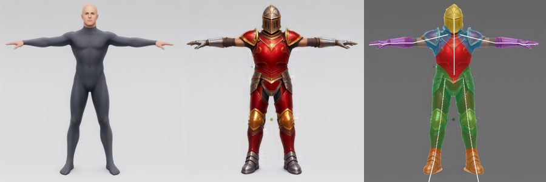

## Materiale comune (una volta per corpo)

| Passo | Come | Tempo |
|---|---|---|
| Corpo base | Qwen-Image 2.1, T-pose, calzamaglia; scelto 1 seme su 2 | 17–49 s |
| Concept sullo stesso corpo | **Inpainting in due passate** sull'immagine del corpo: busto, gambe e testa a intensità 0,9 con le braccia bloccate, poi le braccia a 0,8 per i guanti. Con una passata sola c'è un salto: a 0,75 l'armatura è dipinta sulla calzamaglia, a 0,88 le braccia escono dalla T-pose | ~1 min più circa 10 tentativi |
| Corpo 3D rigato | Pixal3D → finitura `--skip-paint --views` → SkinTokens `--use_transfer` → `clean_skin_weights.py` | 149 + 26 + 98 + 5 s |
| Maschera degli slot | Lo scheletro del corpo rigato proiettato con la camera di Pixal3D (sagoma IoU 0,93); ogni pixel del concept va all'osso più vicino; lo slot dipende dall'osso e dalla posizione lungo l'osso | 2 s, **nessuna correzione a mano** |
| Animazioni | Clip `walk` e `sword_swing` già nella repo, suonate con `kimodo_retarget.py` | 9–16 s |

## Confronto

Tempi senza contesa della GPU. Durante la prova la GPU era condivisa con altre 3 sessioni, quindi i tempi misurati sono stati fino a 2–3 volte più lunghi.

"Compenetrazioni" conta i vertici della superficie esterna di un pezzo che affondano nella pelle **visibile** del corpo (fuori dalla maschera). È il massimo per pezzo sui fotogrammi della camminata (ogni 3) e del fendente.

"Buchi" conta i vertici del corpo nascosti dalla maschera che in posa restano senza un guscio davanti: lì si vedrebbe attraverso il personaggio.

| Strada | Tempo macchina per set | Qualità visiva | Compenetrazioni (max per pezzo) | Buchi | Corpo coperto | Ritocchi stimati | Licenze | Dove gira |
|---|---|---|---|---|---|---|---|---|
| **B0** Pixal3D intero + segmentazione | **~6,5 min**: Pixal3D 150 s, finitura 50 s, segmentazione 7 s, adattamento 4 s, spada a parte ~3 min | **La migliore**: fedele al concept, pezzi coerenti fra loro; bordi di taglio aperti | ≤ 3% per 8 pezzi su 9; guanto destro 9% (camminata) / 11% (fendente) | 1,4% / 1,9% | 83% | **20–35 min** | MIT + DINOv3 (Pixal3D), Qwen Research License (immagini) | Windows |
| B1 = B0 + HoloPart | ~22 min (HoloPart 865 s, di cui 596 s sulla GPU; resto dal disco WSL lento) | Geometria quasi uguale a B0, elmo più rumoroso; **texture persa** e non recuperata in 3 tentativi | ≤ 3%; elmo 8% | 1,5% | 78% | 45+ min | + HoloPart MIT | Pixal3D Windows, HoloPart **solo WSL2** (5,5 GiB) |
| C1 ritaglio per parte → Pixal3D | ~22 min (7 Pixal3D da ~150 s + finiture) | Pezzi nitidi, ma **manca ciò che nel concept era coperto**: busto a rombo senza fianchi, spallaccio con un pezzo di pettorale, punta sull'elmo; si vede la calzamaglia | busto 11%, spallacci 9%, elmo 3%, resto ≤ 3% | 2,3% | 70% | **60+ min** | come B0 | Windows |
| C2 ritaglio + completamento (inpainting) | come C1 + 15 s per pezzo | Più nitido di C1, ma **non completa** le parti coperte; senza maschera la forma cambia poco | non misurato (stessi limiti di C1) | – | – | 60+ min | come B0 | Windows |
| C3 un'immagine per parte con modifica (`-r`) | 20–30 s per immagine | Busto e spallaccio interi e puliti; **3 slot su 6 falliti** al primo tentativo (guanti: immagine vuota; gambe: solo due ginocchiere; stivali: esce un guanto); elmo con disegno cambiato | non misurato: si ferma all'immagine | – | – | 40–60 min di tentativi e scelta, poi come C1 | Qwen Research License | Windows |
| A OmniPart con le maschere (solo riferimento interno) | ~18 min: inferenza 1073 s, di cui 888 s sulla GPU; più 11 min una volta per sessione per copiare 8 GB di pesi in RAM | **Pezzi chiusi e completi**, busto intero anche dietro; ma meno dettaglio (superfici a blocchi, elmo semplificato con la faccia visibile), un buco nello stinco, **nessuna texture** (il passo che la crea è fallito) | **≤ 2,1%**, le più basse | 0,7% | 86% | 60+ min (texture di tutto il set, elmo, dettaglio) | **PartField non commerciale: non utilizzabile per il gioco** | **Solo WSL2**, con una patch (xformers sceglie un kernel per Hopper che su Blackwell fallisce); VRAM 11,6 GiB, 15,2 riservati su 16 |

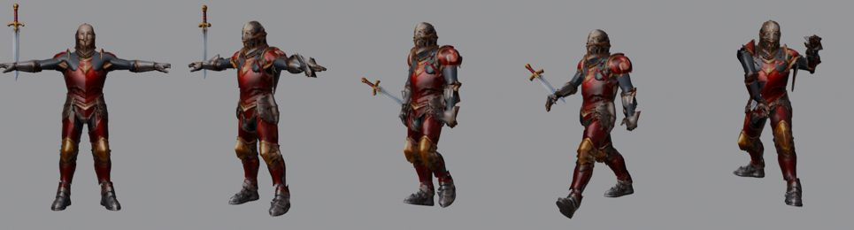

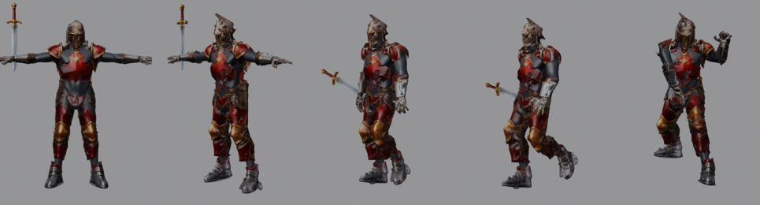

Immagini per parte. In alto C1 (ritagli: mancano le zone coperte); in basso C3 (modifica con riferimento: guanti vuoti, gambe e stivali sbagliati).

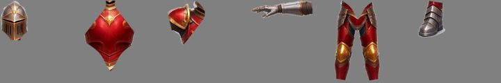
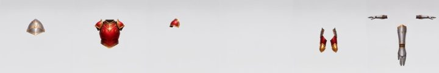

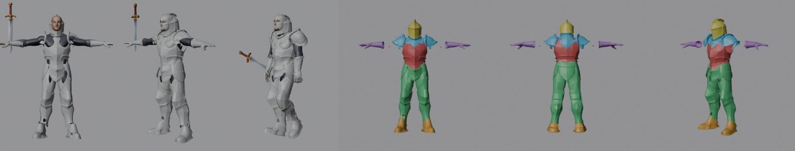

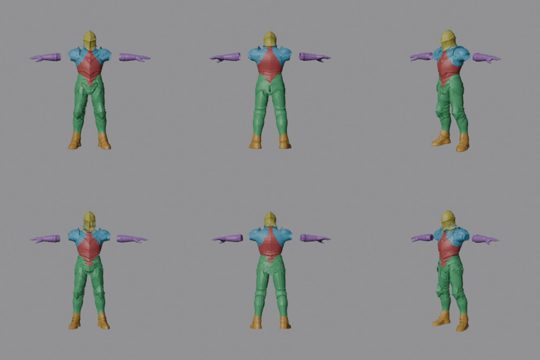

### Ritocchi stimati, voce per voce

- **B0**:
  - guanto destro da allargare o spostare (10 min);
  - bordi di taglio da chiudere (automatizzabile; a mano 10 min);
  - impugnatura della spada orientata secondo la clip (una volta per tipo d'arma, 5 min);
  - spallacci contro il braccio nelle pose estreme (correttivo di posa, 10 min).
- **B1**: come B0, tranne i bordi di taglio, più la texture da rifare (30+ min o sviluppo) e la visiera dell'elmo da pulire.
- **C1**: fianchi del busto da modellare (30 min), spallaccio da ripulire (15 min), elmo (10 min), giunture scoperte (10+ min).
- **C3**: rigenerare e scegliere 3–4 immagini su 6 (5–10 min l'una), poi gli stessi passi di C1, con una fedeltà al concept minore.

## Cosa ha insegnato l'adattamento (uguale per tutte)

1. **Pixal3D genera pezzi pieni, non gusci.** La tecnica standard presuppone gusci cavi fatti da un artista.
   - Ho provato a svuotarli (togliendo le facce dentro il corpo o rivolte verso il corpo, poi Solidify). Le compenetrazioni scendono molto (busto dal 36% al 5%), ma i pezzi diventano sbrindellati.
   - Tenerli pieni e **nascondere il corpo sotto con la maschera** rende molto meglio (immagine sotto: sopra svuotati, sotto pieni).
   - Svuotare non serve.
2. **Una vista frontale non dice nulla di affidabile sulla profondità.** Per i pezzi isolati (strada C) la profondità si allarga fino a coprire la zona del corpo più un margine. Nella strada B non serve, perché tutto il set ha una profondità coerente.
3. **Guanti e stivali vanno riallineati all'osso del corpo.** Nel concept le braccia sono un po' più basse (8,5° e 5 cm): con un solo allineamento globale i guanti diventavano lembi appesi sotto gli avambracci. Basta ruotare l'asse principale del pezzo sull'osso e centrarlo.
4. **Gabbia fitta**: voxel da 7 mm e 5000 facce invece di 12 mm e 1500. Somma delle compenetrazioni da 0,42 a 0,31.
5. **L'elmo chiuso** si adatta con la gabbia (orlo fuori dal collo: dal 12% al 3%) e poi si pesa al 100% sulla testa.
6. **Maschera del corpo coperto**: un vertice del corpo è coperto se un raggio lungo la sua normale incontra un guscio entro 6 cm. Il primo criterio ("incontra il guscio da dentro") copriva solo il 4% del corpo.
7. **L'arma** è rigida sulla mano destra, ma l'orientamento va preso dalla convenzione dell'impugnatura della clip. Nel fendente la lama attraversa il corpo nel 23–56% dei vertici in un fotogramma, perché l'ho messa verticale per semplicità.

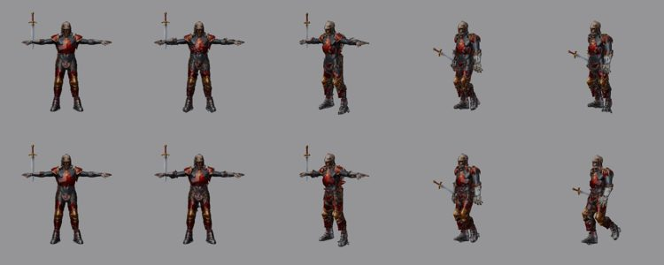

## Approcci recenti (verifica del 15–16/10/2026)

Ricerca sul web, niente scaricato. Licenze lette dai file e dalle schede dove possibile.

| Cosa | Esempi | Licenza | Per noi | Cosa cambierebbe |
|---|---|---|---|---|
| Generatori per parti del 2026 | SAM3D-Part (settembre 2026) | Contiene lo ShapeVAE di Hunyuan3D-2.1 (Tencent) | **Escluso** | – |
| | KaiNinja (settembre 2026, parti di TRELLIS.2) | Pesi non pubblicati | Da seguire | Potrebbe sostituire Pixal3D + segmentazione, se esce con licenza aperta e controllo per slot |
| | FullPart (ICLR 2026) | Codice MIT, pesi senza licenza | Chiedere agli autori | – |
| | PartSAM (ICLR 2026) | Usa il checkpoint di PartField (non commerciale) | Escluso | – |
| | MegaParts, DreamPartGen, PartRAG, PhysForge | Solo articoli | – | – |
| | SAM 3D Objects (Meta, novembre 2025) | SAM License | Richiede ≥ 32 GB; un oggetto per maschera, non adattato al corpo | Solo in cloud, e da far valutare a un legale per la clausola sulle armi |
| Vestiti e armature sul corpo | GarmentCode, ChatGarment | Codice MIT / Apache | Solo stoffa | – |
| | GarmageNet | CC BY-NC-ND | Escluso | – |
| | BAG (Tencent) | Codice non pubblicato | Escluso | – |
| Adattatori | Chaos Outfit di Unreal | – | Pensato per la stoffa e i MetaHuman | – |
| | Mutable | – | Combina pezzi che già calzano, non li adatta | – |
| | CC5 | – | Il manuale dice di spegnere l'adattamento per le armature | – |
| | Marvelous Designer | – | Non gira senza interfaccia | – |
| | RadFit, FitClick | – | Senza interfaccia non documentato; armature rigide non trattate | – |
| | | | **Nessuno sostituisce lo script Blender deterministico** | Si tiene la nostra tecnica |
| Un'immagine per parte | Qwen-Image 2.1 in modifica (provato qui, C3) | **Qwen Research License, solo non commerciale** | 3 slot su 6 falliti | – |
| | Qwen-Image-Edit-2511 | Apache-2.0 | Candidato per una strada C migliore | Da provare: 19,5 GB, gruppo 4 del progetto |
| | FLUX.2 [klein] 4B | Apache-2.0 | Candidato per una strada C migliore | ~13 GB |
| | Altri FLUX | Non commerciali | Esclusi | – |

Conclusione: nessun modello aperto del 2026 cambia la raccomandazione. Due cose da tenere d'occhio:

- KaiNinja, se pubblica i pesi con una licenza utilizzabile;
- un modello di modifica Apache-2.0 (Edit-2511 o klein 4B) per ricavare "una tavola per slot" pulita come **riferimento in più** per B, non al posto di B.

## Cosa servirebbe per la funzione vera

1. **Divisione per slot**:
   - `slot_masks` (proiezione dello scheletro, già senza ritocchi qui);
   - `segment_project` (etichette per faccia: visibili dalla maschera, nascoste dallo scheletro 3D);
   - divisione per lato dei pezzi doppi;
   - chiusura dei bordi di taglio (riempimento più spessore, in Blender).
2. **Adattamento**:
   - lo script `fit_set` ripulito, con le sue parti pure (posizionamento, allineamento degli arti, criteri della maschera) estratte e coperte da test;
   - budget di facce per slot;
   - più corpi base (6), con lo stesso set riadattato per corpo.
3. **Controlli**: le tre misure di questa prova (compenetrazioni visibili, buchi, copertura) come controlli registrati della funzione 7, con soglie.
4. **Unreal**: maschera del corpo come colore dei vertici (attributo `covered`), Leader Pose, arma su un socket della mano con l'orientamento della clip (funzione 5).
5. **Concept sul corpo**: la funzione 2 ha trovato un modo più pulito dell'inpainting: `-r corpo.png` con "aggiungi <pezzo>, non cambiare altro" lascia corpo, posa e contorno identici. È da usare al posto delle due passate. In seguito un modello di modifica Apache-2.0 per una tavola per slot da usare come riferimento.

## Cosa resta incerto

- **Licenza delle immagini**: tutta la catena parte da Qwen-Image 2.1. La sessione della funzione 2 ha letto che la Qwen Research License (§2a) consente solo uso non commerciale del modello. La dichiarazione di Qwen sulle immagini riguarda la proprietà, non l'uso commerciale. Va chiarito per tutto il progetto, non solo per la funzione 4.
- **Un solo set e un solo corpo**: il riadattamento agli altri 5 corpi è stimato, non misurato.
- **Pose**: provate solo camminata e fendente. Gli spallacci sono i pezzi più a rischio nelle pose con le braccia alzate.
- **Le misure sono geometriche** (raggi e punti più vicini). Il giudizio visivo resta sui render; non c'è ancora una prova in Unreal con la maschera applicata.
- **Il disco di WSL è lentissimo** (7–68 MB/s): HoloPart e OmniPart passano più tempo a caricare i pesi che a calcolare. Riguarda chiunque usi WSL2 su questo PC.

## Seguiti

- Licenza di Qwen-Image 2.1 per l'uso commerciale: da decidere a livello di progetto.
- ~~Prova di Qwen-Image-Edit-2511 o FLUX.2 klein 4B per le tavole per slot~~: fatta, vedi l'appendice.
- Prova del set su altri corpi base e su una posa con le braccia alzate.
- Disco WSL: `autoMemoryReclaim=disabled` e spazio libero su C: (91% pieno), se si continua a usare WSL2.
- Pesi di HoloPart (3,8 GB, MIT) ancora in WSL: si possono cancellare, perché la strada consigliata non li usa. Quelli di OmniPart (gruppo 2) sono già stati cancellati il 16/10, come da condizione.

## Appendice: seconda prova della strada C (16/10/2026, sera)

Domanda: con un modello di modifica migliore, un'immagine dedicata per pezzo dà pezzi 3D migliori di quelli ritagliati
dal personaggio intero (B0)? Stesso corpo base, stesse clip e stesso adattamento in Blender della prima prova.
Script locali in `journal/spike-slot-parts/` (`gen_flux.py`, `gen_turbo.py`, `part_images_k.py`, `compare_1024.py`,
`piece_quality.py`, `make_config_c2.py`).

**Cosa è cambiato rispetto alla prima prova**:
- **Concept sul corpo** con la ricetta nuova di Qwen-Image 2.1 Turbo (PR #21: sigma del Turbo, cfg 1.0, euler, 1024 px)
  e `-r body.png`, in 25 s: pulito, con la posa e il contorno del corpo. Le maschere degli slot tornano senza ritocchi.
  A 1536 px le mani restavano nude; a 1024 hanno i guanti.
- **Due modelli di modifica a confronto**:
  - FLUX.2 klein 4B (Apache-2.0, registrato come `WeightSet` nella stessa PR, 12,3 GB);
  - Qwen-Image 2.1 Turbo (già installato).
- **Tecnica che funziona**: si ritaglia il pezzo dal concept con la maschera dello slot, lo si mette su fondo grigio e
  si chiede di "completarlo" con `-r ritaglio.png`. Chiedere invece "prendi solo X dal concept" funziona solo per elmo e
  busto, anche con una seconda formulazione. Attenzione: un ritaglio trasparente passato a `-r` fa vedere al modello
  l'immagine intera sotto la trasparenza, quindi va appiattito.

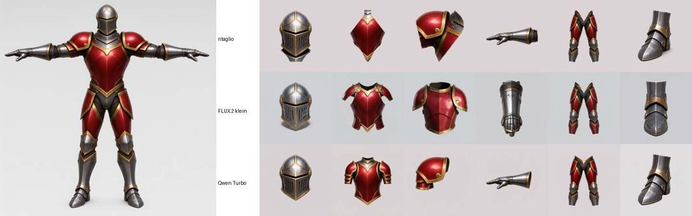

### Immagini per pezzo (6 slot × 3 semi, 1024 px)

| Modello | Pezzi giusti | Note | Tempo a immagine |
|---|---|---|---|
| FLUX.2 klein 4B | **5 su 6**, su tutti i semi | Lo spallaccio diventa una corazza con gli spallacci. Il guanto esce **in verticale** (dita in su) su tutti i semi | 10–14 s |
| Qwen-Image 2.1 Turbo | **6 su 6**, su tutti i semi | Più fedele al ritaglio, verso tenuto; spallaccio singolo pulito | 21 s |

### Qualità del singolo pezzo in 3D

Misure geometriche, nessuna sui pixel:
- i controlli della funzione 7 sul pezzo (`mesh.holes`, `mesh.loose_parts`);
- "interno visto": la quota di raggi, da 14 direzioni attorno al pezzo, che entrano nel guscio da un'apertura.

| | Facce per pezzo | Facce su un bordo aperto | Interno visto | Pezzetti staccati |
|---|---|---|---|---|
| **B0** (ritagliato dal personaggio intero) | 970–10.800, divise fra gli slot | **3,7–18%** (elmo 18%, spallacci 16%, busto 13%) | **20–37%** | 7–23 |
| **C con FLUX.2 klein** | 4.000–10.000, budget pieno per slot | ≤ 0,22% | ≤ 3% | 3–23 |
| **C con Qwen Turbo** | 4.000–10.000 | ≤ 0,17% | ≤ 0,2% | 1–18 |

Le facce di B0 sono 40.000 per tutto il personaggio, divise fra gli slot, mentre ogni pezzo C ha il suo budget e la
sua texture: l'elmo ha 5.990 facce contro 972. Visti da dietro, i pezzi B0 sono a brandelli, senza retro e con pezzi
di altri slot (un pezzo d'elmo nello spallaccio, uno spallaccio nel busto). I pezzi C sono interi.

Due pezzi di Turbo, il busto e il guanto, escono da Pixal3D con **tutte le normali girate verso l'interno**: sono chiusi,
ma vanno raddrizzati. `scripts/fix_winding.py` lo fa già.

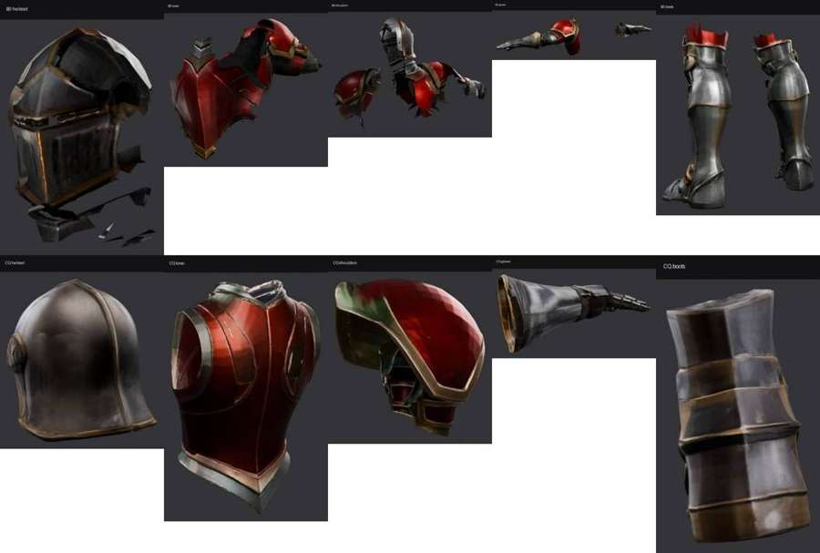

### Sul corpo (camminata / fendente)

Un pezzo fatto da solo non sa dov'era sul corpo. Due modi provati:
- **Allinearlo al pezzo B0 dello stesso slot** (assi principali più ICP con scala): **non funziona**. I gusci B0 sono
  parziali, quindi l'ICP rimpicciolisce i pezzi e gira gli stivali.
- **Il riquadro del pezzo nella sua immagine**, riportato al concept invertendo il ritaglio e la scala con cui era stato
  messo sul fondo grigio: **funziona**. Il modello di modifica lascia il pezzo dove l'aveva trovato.

| Strada | Compenetrazioni (peggior pezzo) | Buchi | Copertura | Note |
|---|---|---|---|---|
| B0, concept nuovo | ≤ 2,5% / guanto 4% | 1,4% / 1,3% | 70% | Molto meglio della prima prova (guanto 9–11%): conta la qualità del concept |
| C con FLUX.2 klein (spallacci da B0) | ≤ 3,2% / ≤ 0,8% | 1,2% / 1,6% | 68% | I guanti verticali restano come pale sulla mano |
| **C con Qwen Turbo** | ≤ 3,1%, spallaccio specchiato 6,1% / 4,4% | 1,2% / 1,8% | **71,5%** | Il set più completo; una punta sottile dopo l'adattamento, vicino a una spalla |

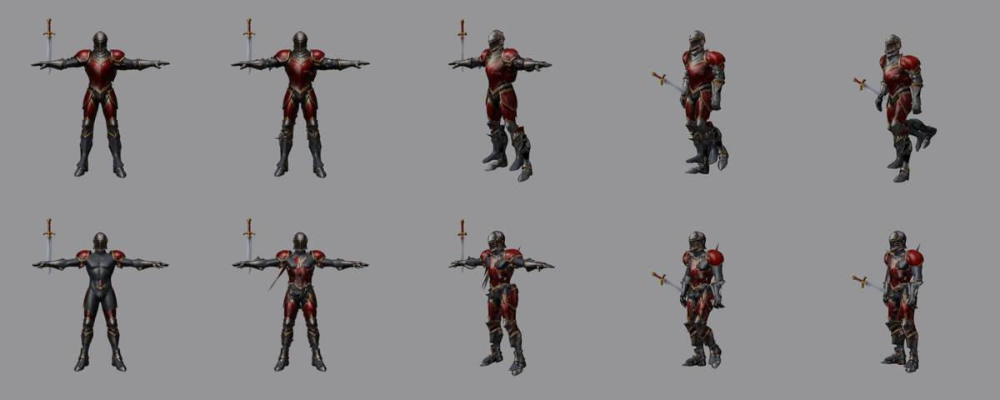

### Tempi di macchina per set (6 slot)

- B0: concept 25 s, Pixal3D sul personaggio 142 s, finitura 21 s, divisione e adattamento su CPU: **circa 4 minuti di GPU**.
- C con Turbo: concept 25 s, 6 immagini da 21 s, 6 Pixal3D (151–614 s misurati con la GPU condivisa con altre sessioni,
  circa 150–250 s quando è libera), 6 finiture da 22 s: **circa 20–30 minuti di GPU**.

### Esito

- **Per i modi 2 e 3 della funzione** i pezzi si fanno con la strada C e Qwen Turbo: concept sul corpo, un ritaglio
  appiattito per slot, completamento con `-r`, Pixal3D per pezzo, posizionamento dal riquadro, adattamento.
  I pezzi sono interi e chiusi, con un budget di facce e una texture ciascuno; sul corpo misurano quanto B0.
- **B0 resta come riserva**: costa un quinto del tempo, utile per un'anteprima veloce, o per uno slot in cui
  l'immagine dedicata fallisce.
- **FLUX.2 klein 4B** non serve alla strada scelta. Resta nel catalogo, scaricabile su richiesta, se serve un modello
  Apache-2.0. I suoi pesi di prova sono stati cancellati alla fine.
- **Da sistemare nella funzione vera**:
  - raddrizzare le normali (`fix_winding.py`);
  - lo spallaccio specchiato (6%), che va adattato per lato invece di essere specchiato;
  - togliere le punte che la gabbia lascia vicino alle spalle;
  - il tempo, perché 6 Pixal3D a set costano.
- **Incertezze**: un solo set, un solo corpo, tre semi per immagine; le soglie dei controlli restano provvisorie.
