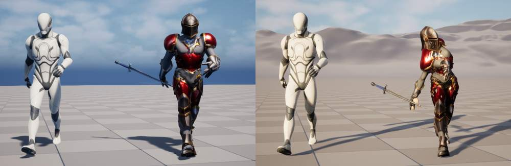
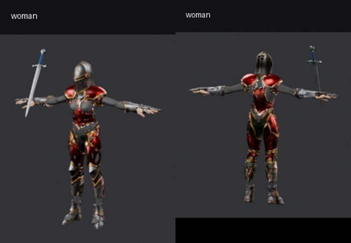
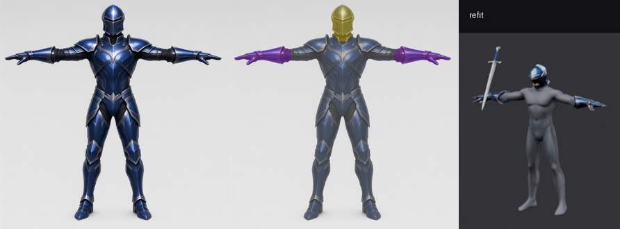
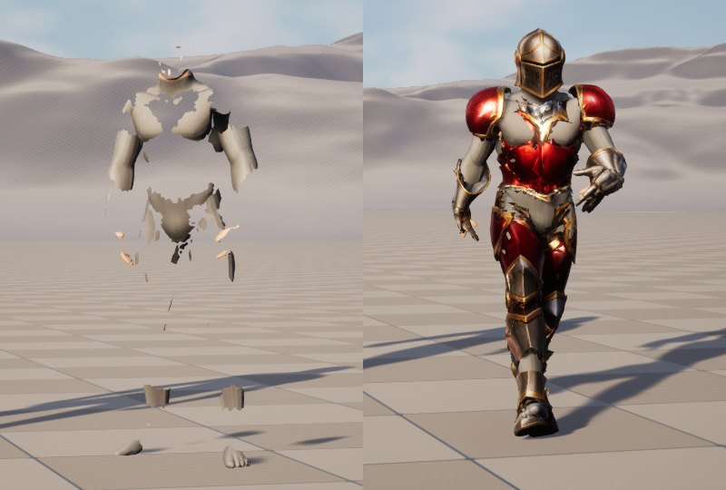
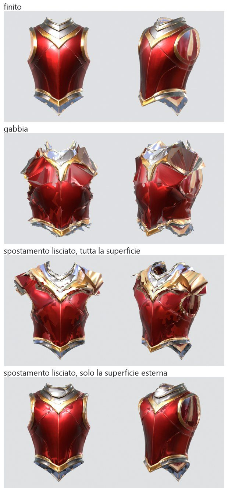
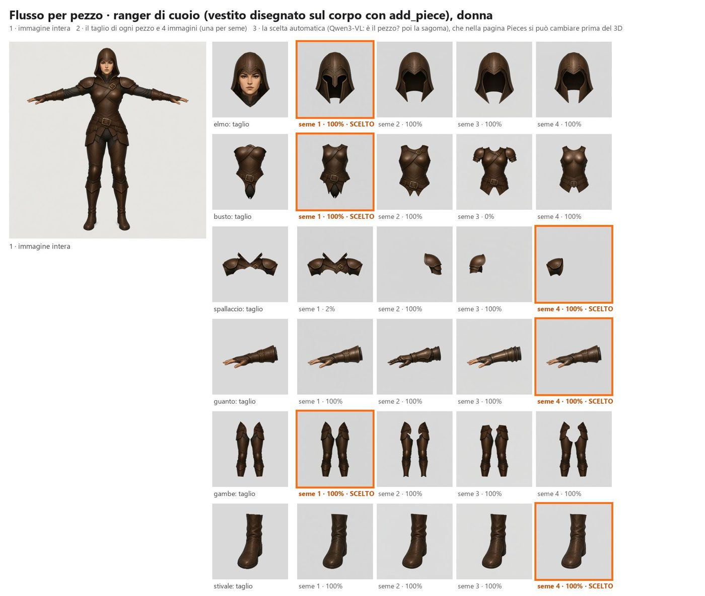

# Funzione 4: personaggi in pezzi e equipaggiamento su un corpo base (progetto)

Data: 16 ottobre 2026, aggiornato la sera dello stesso giorno con i tre modi e l'esito della seconda prova della strada C.
Stato: **implementato** (PR #31, #35, #38, #40, #41, #42, #44 e la PR 9); accettazione nelle sezioni 12 e 13.
Piano: [`2026-10-15-auroconts-asset-pipeline.md`](2026-10-15-auroconts-asset-pipeline.md), funzione 4.
Prove che lo precedono: [`2026-10-15-slot-parts-spike.md`](2026-10-15-slot-parts-spike.md), con l'appendice sulla strada C.

In una riga: nello studio si sceglie **come** fare un personaggio, fra tre modi.
1. Un pezzo solo.
2. Vestito, diviso in pezzi che combaciano.
3. Corpo nudo più set di equipaggiamento da indossare, come in 4Story e in Auroconts.

I modi 2 e 3 usano gli stessi slot, lo stesso adattamento al corpo in Blender, gli stessi controlli in tre pose e la
stessa uscita per Unreal.

## 1. Decisioni prese (16/10/2026)

Approvate dall'utente, riferite dal coordinatore:

- **Tre modi separati**, scelti nello studio (sezione 1b).
- **L'utente sceglie quali pezzi e quanti**, slot per slot.
- **Il concept sul corpo si fa con `-r corpo.png`**, come ha trovato la funzione 2, al posto dell'inpainting in due passate.
- **Immagini con Qwen-Image 2.1 Turbo** (ricetta predefinita dalla PR #21: `--sigmas qwen-image-2.1-turbo`, cfg 1.0,
  euler, 1024 px). AssetFurnace non è commerciale: la licenza di Qwen va bene. FLUX.2 klein 4B (Apache-2.0) resta
  registrato come alternativa.
- **I pezzi (modi 2 e 3) si fanno con la strada C**: un'immagine pulita per pezzo, ricavata dal ritaglio del concept
  con Qwen Turbo, poi Pixal3D per pezzo. Lo dice la seconda prova (sezione 10). B0 resta come riserva per slot.
  HoloPart e OmniPart restano esclusi.

## 1b. I tre modi

| | 1. Un pezzo solo | 2. Vestito, diviso in pezzi | 3. Corpo nudo + equipaggiamento |
|---|---|---|---|
| Cosa si genera | Il personaggio vestito | Il personaggio vestito | Il corpo base nudo (calzamaglia), poi uno o più set di pezzi su quel corpo |
| Corpo sotto | No | Sì: il corpo base su cui è nato il concept; se il concept arriva da fuori, il corpo si ricava togliendo l'armatura con una modifica `-r` ("stessa persona, stessa posa, in calzamaglia"), poi Pixal3D e rig | Sì: è il punto di partenza |
| Pezzi | Nessuno | Gli slot scelti, ricavati dal concept del vestito | Gli slot scelti, set per set; i set si cambiano pezzo per pezzo |
| Adattamento al corpo, maschera del corpo coperto | No | Sì | Sì |
| Controlli | Quelli di oggi (funzione 7) | Più `fit.clipping` e `fit.holes` | Come il 2 |
| Uscita per Unreal | Un modello rigato | Corpo più pezzi sullo stesso scheletro | Come il 2, con più set per corpo |
| Codice nuovo | Nessuno: è il flusso attuale, con un nome nello studio | Tutto quello di questo progetto | Come il 2, più la libreria dei corpi e dei set |

Il modo 1 esiste già. **Il 2 e il 3 sono lo stesso motore**. Nel 2 il concept del vestito nasce sul corpo base e si
butta dopo l'uso; nel 3 il corpo resta e si generano più set sopra. La differenza sta nello studio e nella libreria,
non nella pipeline.

## 2. Cosa c'è già

| Cosa | Dove | Stato |
|---|---|---|
| Profilo dei controlli per un pezzo | `image_to_3dlab/checks/profiles/equipment_part.json` | Su `main`: facce ≤ 8000, 1 materiale, buchi più tolleranti |
| Uscita Unreal di un pezzo | `scripts/export_unreal.py --kind equipment --body RIGGED.glb` | Su `main`: misura, verso e scheletro presi dal corpo |
| Deformazione in posa | controllo `rig.deformation` (funzione 6) | Su `main` |
| Clip per umanoidi | `image_to_3dlab/motions/` + `scripts/kimodo_retarget.py` (`walk`, `sword_swing`…) | Su `main` |
| Immagini | `sd-cli` con Qwen-Image 2.1 Turbo (`viewer/image_api.py`, ricetta della PR #21); modifica con riferimenti in `image_to_3dlab/concept/` (funzione 2) | Su `main` |
| Normali girate | `scripts/fix_winding.py` | Su `main`: serve per i pezzi che Pixal3D gira tutti all'interno |
| 3D, rig | Pixal3D, finitura, SkinTokens, `clean_skin_weights.py` | Su `main` |
| Script della prova | `journal/spike-slot-parts/` (locali) | Da ripulire: `roles.py`, `camera.py`, `slot_masks.py`, `part_images.py`, `flatten_cuts.py`, `make_config_c2.py`, `fit_set.py`, `piece_quality.py`; `segment_project.py` per la riserva B0 |

Niente pesi nuovi: tutto ciò che serve è già installato.

## 3. Gli ingressi

### Il corpo base

Un corpo base è un personaggio fatto con i passi che esistono:
- immagine frontale in T-pose con calzamaglia;
- Pixal3D a vista singola (serve la sua camera per proiettare);
- SkinTokens con i pesi puliti.

Nello studio un bottone **"Usa come corpo base"** lo registra in `output/bodies/<nome>/body.json`, con:
- l'immagine;
- il GLB rigato;
- la camera di Pixal3D;
- i ruoli delle ossa (testa, mani, piedi… trovati dalla forma dell'albero, come nella prova);
- due etichette libere (per Auroconts: razza e sesso).

Un corpo senza camera di Pixal3D o non umanoide viene rifiutato con il motivo.
Nel modo 2, con un concept arrivato da fuori, il corpo si ricava come detto nella sezione 1b e si registra allo stesso modo.

### La lista dei pezzi

Il catalogo degli slot è fisso. La scelta per slot è dell'utente.

| Slot | Come si fa il pezzo | Scelte |
|---|---|---|
| Elmo | C (immagine dedicata) | sì/no; rigido sulla testa dopo l'adattamento |
| Busto | C | sì/no |
| Spallacci | C | sì/no; **un pezzo o due** (sinistro e destro) |
| Guanti | C | sì/no; sempre due pezzi |
| Gambe | C | sì/no |
| Stivali | C | sì/no; sempre due pezzi |
| Arma | C, dal concept o da un prompt a sé | sì/no; mano destra o sinistra |
| Scudo | C, dal concept o da un prompt a sé | sì/no; avambraccio sinistro |

Per ogni slot si può passare a **B0** (il pezzo ritagliato dal 3D del personaggio intero): è la riserva, più veloce,
da usare per un'anteprima o quando l'immagine dedicata di uno slot non viene.

Uno slot non scelto resta corpo: i suoi pixel non diventano un pezzo e la maschera del corpo lì non nasconde niente.

**Mantello: non nella prima versione.** Da una vista frontale la schiena non si vede, e un mantello vuole la stoffa simulata.
Lo aggiungo dopo una prova a parte (in "Seguiti").

## 4. Il flusso (modi 2 e 3)

1. **Concept sul corpo**: `sd-cli` in modifica con `-r body.png`, ricetta del Turbo a 1024 px.
   - Il prompt è composto dai pezzi scelti: "aggiungi elmo, busto e stivali …, non cambiare altro".
   - Si generano più semi e l'utente sceglie l'immagine.
   - Corpo, posa e contorno restano quelli del corpo base, quindi lo scheletro proiettato combacia.
   - Nel modo 3, per un set nuovo sullo stesso corpo si rifà solo questo passo e quelli dopo.
2. **Maschera degli slot**: lo scheletro del corpo proiettato con la camera; ogni pixel va al segmento d'osso più vicino.
   Restano i soli slot scelti.
3. **Un ritaglio per slot**, appiattito su fondo grigio, con la scala e la posizione segnate. Per i pezzi doppi si
   tiene il lato destro del personaggio.
4. **Un'immagine pulita per pezzo**: modifica con `-r ritaglio.png`, "completa questo pezzo: …, niente corpo dentro".
   Più semi; l'utente può scartarne uno e rigenerarlo.
5. **Pixal3D per pezzo**, con il budget di facce dello slot, poi la finitura e il raddrizzamento delle normali.
6. **Posizionamento**: il riquadro del pezzo nella sua immagine, riportato al concept invertendo il ritaglio.
7. **Adattamento** in Blender, la tecnica della prova:
   - allineamento degli arti per i guanti;
   - gabbia con Shrinkwrap e Surface Deform;
   - pesi copiati dal corpo, al massimo 4 per vertice;
   - elmo, arma e scudo rigidi su un osso;
   - i pezzi doppi si adattano **per lato**, non per specchio: lo spallaccio specchiato era il peggiore (6%);
   - pulizia delle punte che la gabbia lascia vicino alle spalle;
   - maschera del corpo coperto.
8. **Riserva B0**, per gli slot che l'utente sposta su B0: Pixal3D sul concept intero, divisione per slot (maschera per
   le facce visibili, scheletro per quelle nascoste), chiusura dei bordi di taglio, poi lo stesso adattamento.
9. **Controlli** (sezione 5) in tre pose: riposo, camminata, fendente.
10. **Uscita**: una cartella per set e per corpo, `output/sets/<set>/<corpo>/`:
    - un GLB per pezzo;
    - il corpo con la maschera;
    - `<set>.parts.json`, con modo, slot scelti, strada per slot, corpo (nome e SHA-256), misure e licenze (provenienza).
11. **Riadattamento agli altri corpi**: lo stesso pezzo si adatta a ogni corpo; immagini e Pixal3D non si rifanno.
    Si fa una volta per corpo, perché pesi e scheletro sono di quel corpo.

### Codice

- `image_to_3dlab/slot_parts/`, tutto in Python puro e testato:
  - catalogo e scelta degli slot, ruoli delle ossa, camera, maschera, ritagli con la loro trasformazione;
  - posizionamento dal riquadro;
  - la parte pura dell'adattamento (assi degli arti, criteri della maschera, misure);
  - la divisione per la riserva B0.
- `scripts/blender_fit_parts.py`: solo le chiamate a `bpy` (bordi, gabbia, pesi, maschera, pose).
  Riceve un file JSON di lavoro e non contiene nomi, colori o misure di un set preciso.
- `scripts/slot_parts.py`: un solo comando con cinque sottocomandi: `body`, `cuts`, `pieces`, `fit`, `run`.
  Va elencato in `scripts/README.md`.

## 5. Controlli (funzione 7)

Due controlli nuovi, con `needs=("body",)`. `Asset` riceve un campo `body`: il corpo base registrato.

| Controllo | Che cosa misura | Soglie iniziali (dalle prove) |
|---|---|---|
| `fit.clipping` | Peggior quota, fra le tre pose, dei vertici della superficie esterna del pezzo che affondano nella pelle visibile | warn 3%, fail 10% |
| `fit.holes` | Quota del corpo nascosto dalla maschera che, in posa, non ha un pezzo sopra | warn 2%, fail 5% |

- Sono misure geometriche, quindi rispettano la regola "niente controlli sui pixel".
- Sul pezzo da solo valgono i controlli che ci sono già: `mesh.holes`, `mesh.loose_parts`, `mesh.flipped_faces`.
  Nella prova separano bene i pezzi interi (C) dai gusci aperti (B0).
- La **copertura** (quanta parte del corpo è nascosta) dipende dai pezzi scelti: va nei dettagli del sidecar, non è un controllo.
- `rig.deformation` gira su ogni pezzo come sugli altri modelli.
- Ogni pezzo entra nella coda di revisione.
- Le soglie restano provvisorie finché l'utente non ha giudicato i primi set.

## 6. Nello studio

Una pagina nuova, **Personaggi in pezzi**: un modulo mio, `viewer/studio/slot-parts.js`, più `viewer/slot_parts_api.py`.
Nei file condivisi metto solo le righe d'aggancio.

- Per prima cosa si sceglie il **modo**:
  - il modo 1 rimanda al flusso di oggi (Create, poi Steps);
  - il modo 2 parte da un concept del vestito (generato sul corpo, o caricato);
  - il modo 3 parte da un corpo base registrato.
- Poi gli slot con le caselle e le scelte della tabella sopra. Per ogni slot ci sono il prompt del pezzo e la strada
  (C predefinita, B0 di riserva).
- Si sceglie uno dei concept generati, poi le immagini dei pezzi; si avvia, con l'avanzamento come per gli altri lavori.
- **Anteprima**: il visore esistente mostra i pezzi sul corpo; le chip suonano le clip.
- Nel modo 3, una **libreria dei set** per corpo: si cambia un pezzo alla volta.
- Un bottone **"Adatta anche a…"** lancia il riadattamento sugli altri corpi registrati.

## 7. Consegna: PR piccole

| PR | Contenuto |
|---|---|
| 1 | Progetto (PR #20, unita) e questa revisione, con la seconda prova della strada C e FLUX.2 klein nel catalogo |
| 2 | Catalogo degli slot, ruoli, camera, maschera, ritagli; sottocomandi `body` e `cuts` |
| 3 | `-r` in `image_api.py` (riferimenti e file della visione); immagini per pezzo, Pixal3D per pezzo, normali; sottocomando `pieces` |
| 4 | Posizionamento dal riquadro e adattamento (gabbia, pesi, rigidi, pezzi doppi per lato, maschera); sottocomando `fit` |
| 5 | `fit.clipping` e `fit.holes` nella funzione 7, con le tre pose; `Asset.body`; sottocomando `run` e sidecar |
| 6 | Riserva B0: divisione per slot e chiusura dei bordi |
| 7 | Pagina **Personaggi in pezzi** nello studio: i tre modi, la libreria dei set |
| 8 | Uscita per Unreal e riadattamento a un secondo corpo; prova di accettazione |

Dettagli:
- **PR 3 e la funzione 2**: la funzione 2 ha messo su `main` `image_to_3dlab/concept/` (`edit.with_references` per
  `-r` e il file della visione, `prompts.dress` e `prompts.add_piece`, `maps.flatten`, il sidecar `.concept.json`).
  Lo uso così com'è e aggiungo solo il prompt "completa questo pezzo".
- **PR 8, Unreal**:
  - la maschera del corpo va nel colore dei vertici (attributo `covered`), che il materiale usa per nascondere;
  - i pezzi condividono lo scheletro del corpo (Leader Pose);
  - l'arma va su un socket della mano.
  Il resto c'è già nel profilo della funzione 5.

Ogni PR:
- test prima del codice;
- riga in `CHANGELOG.md`;
- script nuovi in `scripts/README.md`;
- Codex al massimo un giro facoltativo, solo P1 veri.

Non unisco io. Dopo ogni PR chiudo il turno con il comando e il risultato.

## 8. GPU e tempi

Per set di 6 slot, sul primo corpo, misurati nella seconda prova:
- concept 25 s a seme;
- 6 immagini per pezzo da 21 s;
- 6 Pixal3D da circa 150–250 s con la GPU libera, più 6 finiture da 22 s;
- adattamento e controlli su CPU, ~3 minuti.

In tutto **20–30 minuti di GPU per set**, contro circa 4 della riserva B0. Il riadattamento a un altro corpo è solo
CPU, ~2–3 minuti stimati.

Il lucchetto della GPU si prende solo mentre `sd-cli` o Pixal3D calcolano, e si libera dopo ogni lavoro.

## 9. Rischi

- **Tempo**: 6 Pixal3D a set. Per Auroconts sono 427 forme di armatura: va messo in lotti di notte (funzione 1).
- **Un solo corpo misurato**: con proporzioni diverse (razze), il riadattamento può aumentare le compenetrazioni.
  La PR 8 lo misura su un secondo corpo.
- **Braccia alzate**: non provate. Gli spallacci sono i pezzi più a rischio.
- **Immagini per pezzo**: tre semi su tre sono venuti con Turbo su questo set; su set più strani (mantelli, pezzi
  asimmetrici) può servire scegliere a mano. Per questo lo studio fa vedere le immagini prima di Pixal3D.
- **Concept che sposta il corpo**: se un seme cambia la posa, lo scheletro proiettato non combacia.
  L'IoU della sagoma del corpo dentro il concept lo scarta prima di continuare (geometria sulle maschere, non pixel).

## 10. Esito della seconda prova della strada C

Fatta il 16/10/2026: dettagli nell'[appendice del rapporto](2026-10-15-slot-parts-spike.md#appendice-seconda-prova-della-strada-c-16102026-sera).
- Qwen Turbo completa i ritagli: **6 pezzi su 6** su tre semi. FLUX.2 klein: 5 su 6, con i guanti girati.
- I pezzi C sono interi e chiusi: facce su un bordo aperto ≤ 0,2% contro 4–18% di B0; interno visto ≤ 0,2% contro 20–37%.
- Sul corpo misurano quanto B0: compenetrazioni ≤ 3,1% (spallaccio specchiato 6%), buchi 1,2–1,8%, copertura 71,5%.
- Il posizionamento dal riquadro funziona; l'allineamento al pezzo B0 no.
- FLUX.2 klein 4B resta nel catalogo, scaricabile su richiesta. I pesi di prova sono stati cancellati.

## 11. Come provo l'accettazione

1. Due corpi base registrati, per esempio uomo e donna della stessa razza.
2. Modo 3: un set scelto nello studio, con elmo, busto, spallacci separati, guanti, stivali, niente gambe, più una spada.
   Poi un secondo set sullo stesso corpo, con un pezzo cambiato.
3. Modo 2: un concept vestito caricato da fuori, diviso nei pezzi scelti.
4. `fit.clipping` e `fit.holes` almeno warn su tutti i pezzi, in tutte e tre le pose, sul primo corpo; misurati anche sul secondo.
5. In Unreal 5.8: i pezzi seguono il corpo nella camminata, il corpo sotto non buca, la spada sta nella mano.
   Ci sono un'immagine a metà passo e una a metà fendente.
6. Tutti i pezzi nella coda di revisione per il giudizio dell'utente.
7. `PYTHONPATH=. pytest -q` e `ruff check` verdi sui file toccati; i test Blender con `--factory-startup`.

## 12. Com'è andata (PR 2–8, 16–17/10/2026)

Le otto PR sono fatte: #31 (slot, maschera, ritagli), #35 (pezzi della strada C), #38 (adattamento), #40 (controlli e
`run`), #41 (riserva B0), #42 (pagina **Pieces** nello studio) e la PR 8 (riadattamento a un altro corpo, uscita per
Unreal, accettazione). Rispetto al progetto:

- **I passi in più che servivano**, trovati provando sul materiale vero:
  - le cuciture UV del glTF vanno saldate prima della gabbia, altrimenti isole di vertici volano via (la "punta" vicino
    alla spalla, che c'era già nella prova);
  - Surface Deform si lega o no per piccoli dettagli della gabbia: si provano più grane prima di Mesh Deform;
  - un ultimo passaggio porta fuori dalla pelle i vertici rimasti dentro;
  - l'elmo è rigido e non passa dalla gabbia: si ingrandisce, se serve, fino a contenere la testa con un margine del 15%,
    e segue l'osso della testa che porta più vertici;
  - arma e scudo restano fuori dalla maschera del corpo (la mano sotto l'impugnatura deve vedersi) e non hanno
    `fit.holes`, che per un pezzo tenuto in mano non ha senso.
- **Nel modo 3** il vestito si aggiunge alla calzamaglia (`add_piece`), invece di vestire tutto il corpo: gli slot non
  scelti restano nudi.
- **Il colore dei vertici** del corpo è bianco ovunque, con alfa 0 sotto i pezzi: i visori glTF, che moltiplicano il
  colore per COLOR_0, non lo scuriscono, e in Unreal l'alfa va nell'Opacity Mask.
- **`kimodo_retarget.py`** ora accetta gambe che pendono da una catena del bacino sotto la radice: SkinTokens ha rigato
  così il secondo corpo.

### Accettazione

- **Due corpi base**: il corpo della prova (uomo, 180 cm) e una donna fatta con la stessa ricetta (Turbo, Pixal3D,
  SkinTokens; 170 cm), ognuno con camminata e fendente di Kimodo.
- **Modo 3, dall'inizio alla fine** (`slot_parts.py run`, vestito a parole sul primo corpo, elmo, guanti e una spada fatta
  a sé): 17 minuti di macchina, più 9 di attesa della GPU condivisa. Ogni pezzo è finito nella coda di revisione e c'è
  `blue-knight.parts.json` con le licenze.
- **Set completo**: i 6 pezzi Turbo della seconda prova più la spada, adattati al primo corpo in 9 secondi, poi portati sulla
  donna con `refit` in circa 2 minuti, senza nuove immagini né nuovo 3D. Corpo coperto: 74% e 72%.

| Pezzo | Primo corpo: compenetrazioni / buchi | Secondo corpo: compenetrazioni / buchi |
|---|---|---|
| Elmo | 0% / 3,4% | 1,1% / 5,6% |
| Busto | 0,4% / 1,1% | 0,3% / 2,6% |
| Spallaccio destro | 5,9% / **5,9%** | 2,9% / **6,7%** |
| Spallaccio sinistro | 5,3% / 3,9% | 4,3% / **9,8%** |
| Guanto destro | 0,3% / 0,8% | 1,5% / **5,5%** |
| Guanto sinistro | 0,3% / 0,9% | 3,2% / 4,2% |
| Gambe | 0% / 1,2% | 0,3% / 1,3% |
| Stivali | 0% / ≤ 0,3% | 0% / ≤ 1,0% |
| Spada | 0% / – | 0,3% / – |

Misure su riposo più 8 istanti di camminata e 8 di fendente. Le compenetrazioni restano sotto il 6% ovunque (soglia di
fail 10%). I buchi superano il 5% sugli spallacci (entrambi i corpi) e su elmo e guanto destro del secondo corpo: lo
spallaccio è il pezzo più difficile, come diceva la prova, e il riadattamento a un corpo con le braccia più basse lo
peggiora. Questi pezzi sono in revisione come fail, non nascosti.

- **In Unreal 5.8.3** (`unreal_import_check.py`, il controllo della funzione 5): su entrambi i corpi i 22 file passano.
  - Misura giusta (180 e 170 cm), base a terra, un solo scheletro per corpo, nessuno nuovo creato dai pezzi.
  - L'IK Rig riconosce lo scheletro; l'idle e la camminata di Manny si ritargettano, con i piedi che non si incrociano.
  - I pezzi seguono il corpo con Leader Pose e la spada sta in mano.

- **Test**: suite completa senza `PYTHONUTF8` verde sul ramo della #42 (3831 passati, 46 saltati). Per la PR 8, i test
  della funzione 4, dei controlli, dell'uscita Unreal e di Kimodo.

## 13. I seguiti chiusi (PR 9, 17/10/2026)

L'accettazione della PR 8 aveva quattro pezzi in fail per buchi oltre il 5%. Due cose li hanno portati tutti sotto l'1%,
senza toccare i pezzi:

- **La maschera tiene conto delle pose.** Prima si calcolava a riposo: la pelle sotto un pezzo spariva anche se, alzando
  il braccio, lo spallaccio se ne staccava. Ora la pelle resta nascosta solo se un pezzo la copre a riposo **e** in 8
  istanti di ogni clip del corpo (`fit.pose_frames`), con un raggio verso fuori entro 6 cm. Le clip arrivano dal
  `body.json` (`--clip`), anche nel riadattamento. Il corpo coperto scende di poco: 72% sul primo corpo, 69% sulla donna.
- **I buchi si misurano contro tutto il set.** Un buco è pelle nascosta che in posa non ha **nessun** pezzo sopra, non
  solo quello misurato: dove lo spallaccio si alza ma il busto copre ancora, la pelle non si vede. Il set sono gli altri
  GLB accanto al corpo mascherato, arma e scudo esclusi (`fit_checks.worn_set`).

| Pezzo | Primo corpo: compenetrazioni / buchi | Secondo corpo: compenetrazioni / buchi |
|---|---|---|
| Elmo | 0% / 0,2% | 1,1% / 0,4% |
| Busto | 0,5% / 0,1% | 0,3% / 0,2% |
| Spallaccio destro | 6,7% / 0,8% | 2,9% / 0,4% |
| Spallaccio sinistro | 5,5% / 0,2% | 4,6% / 0,4% |
| Guanto destro | 0,9% / 0,6% | 1,7% / 0,5% |
| Guanto sinistro | 0,3% / 0,1% | 3,3% / 0,1% |
| Gambe | 0% / 0,1% | 0,3% / 0,1% |
| Stivali | 0% / 0% | 0% / ≤ 0,2% |

Stesse pose di prima (riposo, 8 istanti di camminata e 8 di fendente), stesso set. Nessun fail su entrambi i corpi: i
buchi sono tutti sotto il warn del 2%, le compenetrazioni sotto il fail del 10%. Gli spallacci restano in warn per le
compenetrazioni (5–7%), come nella PR 8. La spada non era in questo giro: la maschera non la riguarda.

- **Il riadattamento lungo l'asse dell'osso non serve** su questi due corpi: dopo il riadattamento box su box la donna
  ha buchi sotto lo 0,5% su ogni pezzo. Resta un'idea per proporzioni molto più lontane.
- **L'Opacity Mask in Unreal è automatica.** Prima il corpo restava intero sotto l'armatura.
  - L'uscita per Unreal esporta il colore dei vertici del corpo, quando l'alfa scende sotto 0,5, e mette il suo
    materiale glTF in `alphaMode` MASK.
  - L'importazione glTF di Unreal 5.8.3 non legge l'alfa dei vertici: `unreal_import_check.py` costruisce, accanto al
    corpo, `M_<corpo>_Masked`. È Masked, con le texture del corpo come parametri e l'alfa di Vertex Color in Opacity
    Mask, e lo mette su ogni slot del corpo.
  - Il controllo `opacity_mask` lo verifica. Su entrambe le prove, il corpo da solo e il set intero (10 file), tutto
    passa.

### Review di Codex del lavoro unito (17/10/2026)

Ogni punto verificato sulle righe citate; tutti veri, corretti con un test ciascuno.

- Uscita per Unreal senza alfa (il `covered` reimportato si chiama `Color`): già risolto in #46, che sceglie il colore
  dall'alfa, non dal nome.
- Stop fermava solo lo script: ora ferma tutto l'albero dei processi e aspetta prima di lasciar partire un altro set.
- Dita omesse dal classificatore lette come busto: ora prendono il ruolo dell'osso classificato più vicino.
- `shoulders:split` non arrivava all'adattamento: senza "due pezzi" gli spallacci escono in un file solo, anche dopo
  il refit. I due lati condividono texture e UV per specchio, quindi `equipment_part` conta una volta i triangoli UV
  copiati (`uv.overlap` con `copies_ok`).
- Selettore del corpo vuoto dopo la registrazione: si ridisegna quando cambia l'elenco dei corpi.
- Concept o corpo già trasparenti: la sagoma viene dalla loro trasparenza.
- Set con sola arma o scudo: non nasconde pelle. Un rig con un solo giunto testa/collo: l'elmo si adatta a quel giunto.

In più, trovati provando il modo 2 (B0) sui due corpi:
- i tappi dei tagli stendevano le UV su tutto l'atlante (`uv.overlap` 70–100%);
- le gambe superavano il budget di facce;
- un refit girava al contrario un'isola chiusa di uno spallaccio.

Ora il set C e il set B0 passano senza fail su entrambi i corpi.

## 14. L'adattamento tiene la forma dei pezzi (17/10/2026)

Il coordinatore ha notato che i pezzi erano più semplici del concept. Sono andato a cercare il punto in cui si perde il
dettaglio, rendendo ogni pezzo prima e dopo ogni passaggio.

- **Immagine e 3D tengono il dettaglio.** Elmo con visiera e fori, stivale a placche, guanto: tutto c'è, anche nella
  geometria in argilla.
- **Lo perdeva l'adattamento.** La gabbia proiettata sul corpo (Shrinkwrap più Surface Deform) riduceva il pettorale a
  schegge su entrambi i corpi, e i controlli non se ne accorgevano: compenetrazioni e buchi restavano bassi.
- **La causa.** Il pettorale di Pixal3D è cavo e la sua parete interna sta, per costruzione, dentro il torace. La gabbia
  e la spinta finale la portavano fuori dalla pelle, attraverso la parete esterna.
- **Ora (`push_off_skin`, `fit.smooth_push`).**
  - Si spinge fuori solo la superficie che guarda verso l'esterno.
  - I vertici vicini seguono con uno spostamento lisciato, che cala con la distanza: un'ammaccatura diventa un
    rigonfiamento morbido.
  - Si ripete fino a tre volte.
  - La parete interna resta dov'è, nascosta.
  - La gabbia resta come `fit_method: "cage"`.
- **Provato e scartato.**
  - Spingere tutta la superficie.
  - Dare prima spazio al pezzo con una scala: per liberare le spalle serviva un pettorale largo il 60% in più.
  - Allentare il filtro della parete: le spalline del pettorale tornavano a svasarsi.

| Set C | Primo corpo: compenetrazioni / buchi | Secondo corpo: compenetrazioni / buchi |
|---|---|---|
| Elmo | 0% / 0,1% | 0,9% / 0,4% |
| Busto | 2,3% / 0% | 1,2% / 0% |
| Spallacci (un pezzo) | 3,1% / 0,1% | 1,5% / 0,2% |
| Guanto destro / sinistro | 0,3% / 0,9% · 0,3% / 0,1% | 1,4% / 1,1% · 2,4% / 0,5% |
| Gambe | 0,5% / 0% | 0,4% / 0% |
| Stivali | 0,1% / 0,1% | 0,1% / 0,1% |

- Nessun fail. Con la gabbia il busto era allo 0,5%: misurava poco proprio perché il pezzo era schiacciato sulla pelle.
- Corpo coperto: 82% e 80%.
- Il set B0 è senza fail su entrambi i corpi.

## 15. Più immagini per pezzo, e quella giusta (17/10/2026)

L'utente ha precisato il flusso dei modi 2 e 3:
1. prima l'immagine intera del personaggio o del set;
2. poi un'immagine per ogni pezzo, ricavata da quella;
3. poi si sceglie l'immagine giusta di ogni pezzo, e solo quella va al 3D.

Su main mancava il punto 3: con più semi si prendeva il primo.

**Ora** (`slot_parts/candidates.py`).
- Con più semi ogni immagine riceve due punteggi.
  - **È il pezzo?** Qwen3-VL, il giudice della bibbia di stile, risponde sì o no. Per lo spallaccio la domanda chiede
    che non ci sia niente attaccato: niente piastra del petto o della schiena, niente cinghia, secondo spallaccio o
    bracciale.
  - **La sagoma**: copertura della maschera dello slot meno ciò che sta molto fuori. Decide solo i pareggi del
    giudice (arrotondato a due decimali). Pesata nel punteggio, premiava chi ricopia il taglio, e il taglio di uno
    spallaccio contiene un pezzo di pettorale.
- Il migliore va al 3D da solo. Tutto finisce in `pieces/candidates.json`.
- Se nessuna immagine convince il giudice (tutte sotto 0,5), il pezzo è segnalato: servono altri semi o altre parole.
- **Nello studio** la pagina Pieces fa 3 immagini per pezzo (semi 1, 2, 3).
  - Con "fammi vedere le immagini prima del 3D", il lavoro si ferma dopo le immagini (`run --stop-at-pictures`).
  - La pagina mostra i candidati con il migliore spuntato. L'utente cambia quelli che vuole e preme "Make the 3D"
    (`run --resume --pick`).
  - Arma e scudo stanno fra i candidati come gli altri pezzi: un'immagine per seme, senza punteggio (non c'è un
    ritaglio con cui confrontarle), la prima spuntata.
- **Il vestito (modo 3)** si può scegliere prima dei pezzi: "Outfit pictures (seeds)" lo disegna una volta per seme e,
  con "let me pick the outfit", il lavoro si ferma (`run --stop-at-concept --concept-seeds 3,4,5`). La scelta
  (`run --resume --pick concept=4`) va avanti da quel vestito, anche fino alla scelta dei pezzi. Agenti:
  `pieces_run(concept_seeds=, choose_concept=)` e `pieces_pick({"concept": 4})`.
- **Un set fatto** ha nella pagina Pieces "Fit again", "Carry to body" ed "Export for Unreal", come i comandi `fit`,
  `refit` e `unreal` e gli strumenti MCP. Un set portato su un altro corpo ha lì il suo `<set>.parts.json` (con
  `carried_from`; i controlli non vengono portati, perché erano del primo corpo), quindi la pagina lo elenca e lo
  esporta. Una scelta del vestito resta nello stato finché il set non è fatto: un fit fallito riparte da quel vestito.
- Senza Qwen3-VL (llama.cpp non installato) decide la sagoma, e il record lo dice.

**Misura.** Tre vestiti: i due cavalieri rossi delle prove (s3, s7) sull'uomo e un ranger di cuoio disegnato sulla
donna con `add_piece`. In tutto 18 slot e 4 semi ciascuno, 72 immagini, etichettate a vista.

| | Slot con un candidato giusto | Scelta automatica giusta |
|---|---|---|
| Parole di prima, punteggio combinato | 15 su 18 | 14 su 15 (sbagliato uno spallaccio con il pettorale attaccato) |
| Parole nuove, domanda nuova per lo spallaccio, sagoma come spareggio | 18 su 18 | **18 su 18** |

- **Parole di prima.** Nei 3 slot senza candidati giusti la colpa era delle parole predefinite (`pieces.WORDS`).
  - Il busto nominava gli spallacci, e la modifica li disegnava: 8 semi su 8.
  - L'elmo era "a closed helmet", e il cappuccio di cuoio diventava acciaio.
- **Parole nuove.** Busto "senza spallacci né maniche": 8 su 8 puliti. Testa "elmo, cappuccio o cappello come
  disegnato, senza il viso": 4 cappucci su 4.
- **Formulazioni della domanda sullo spallaccio**, misurate sulle 12 immagini:
  - la domanda semplice: 10 su 12 immagini giuste;
  - "c'è altro oltre allo spallaccio?": 9 su 12;
  - quella scelta: 11 su 12.
- **Avvertenza.** Regola e domanda sono state messe a punto su questi stessi tre set: il 18 su 18 va ricontrollato su
  set nuovi.

### Seconda review di Codex (17/10/2026, main dopo #56)

Sei punti, tutti veri sulle righe citate, ognuno corretto con un test che fallisce sul codice di prima:
- la ripresa perdeva arma, scudo, stile e semi;
- lo stato d'attesa spariva prima dell'adattamento;
- un `candidates.json` vecchio sceglieva l'immagine di un giro precedente;
- un set tutto B0 apriva il log del giudice in una cartella mai creata;
- in Unreal un solo materiale mascherato per tutti gli slot del corpo;
- il test delle copie UV ordinava U e V separatamente.

## Seguiti

- Mantello: prova a parte, con la vista di schiena (funzione 2, caso 4) e la stoffa in Unreal. La prova su un set
  vero (`red-gold-knight`, 17/10) lo conferma: non c'è uno slot per il mantello, quindi un mantello nel vestito resta
  disegnato nel concept ma non diventa un pezzo.
- La tutina del corpo base si vede fra i pezzi, sulle braccia sopra gli spallacci, all'inguine e alle caviglie (stessa
  prova): i pezzi non arrivano a coprirla. Da provare pezzi un po' più lunghi (gambe e spallacci) o una maschera del
  corpo più larga in quei punti.
- Spallacci: le compenetrazioni restano al 5–7% (warn). Da provare una gabbia più fine sulla spalla, o lo spallaccio
  rigido sulla clavicola come l'elmo sulla testa.
- Riadattamento lungo l'asse dell'osso: non serve sui due corpi provati (sezione 13); da riprendere con un corpo dalle
  proporzioni molto diverse.
- Pesi di HoloPart: cancellati dal coordinatore il 16/10 insieme alla cartella della prova in WSL.
